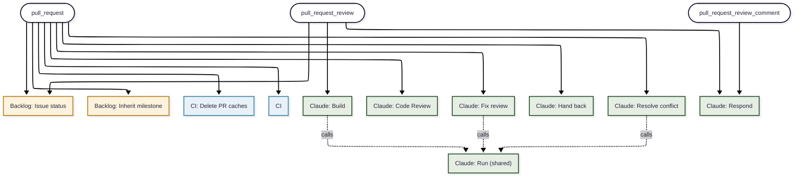
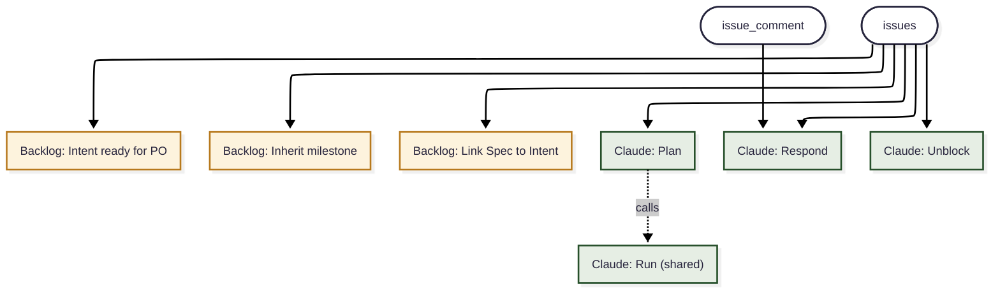
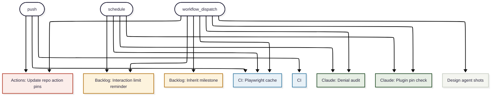

<!-- Written by `npm run workflows:diagram` from the workflow files. Don't edit it by hand. -->

# Workflows

What starts each GitHub Actions workflow, its jobs, and the reusable workflows it calls. How the team uses them: [the README](../../README.md#how-we-work).

| Workflow | Trigger | Filter | Jobs |
| --- | --- | --- | --- |
| Actions: Update repo action pins `actions-pin-update.yml` | push | `main · paths: .github/actions/**, .github/workflows/**` | update-pins |
| | workflow_dispatch | | |
| Backlog: Intent ready for PO `backlog-intent-ready.yml` | issues | `closed` | flag-intent |
| Backlog: Interaction limit reminder `backlog-interaction-limit.yml` | schedule | `0 6 * * 2` | remind |
| | workflow_dispatch | | |
| Backlog: Issue status `backlog-issue-status.yml` | pull_request | `opened, ready_for_review` | status |
| | pull_request_review | `submitted` | |
| Backlog: Inherit milestone `backlog-milestone.yml` | issues | `opened, edited` | inherit |
| | pull_request | `opened, edited, reopened` | |
| | workflow_dispatch | | |
| Backlog: Link Spec to Intent `backlog-spec-link.yml` | issues | `opened` | link-spec |
| CI: Delete PR caches `ci-cache-cleanup.yml` | pull_request | `closed` | delete |
| CI: Playwright cache `ci-playwright-cache.yml` | push | `main · paths: package-lock.json, .github/workflows/ci-playwright-cache.yml` | seed |
| | schedule | `0 5 * * 1,4` | |
| | workflow_dispatch | | |
| CI `ci.yml` | pull_request | `opened, synchronize, reopened, ready_for_review` | lint · typecheck · format · test · coverage · boundaries · words · image · e2e |
| | push | `main` | |
| Claude: Build `claude-build.yml` · calls Claude: Run (shared) | pull_request_review | `submitted` | approve · build |
| Claude: Code Review `claude-code-review.yml` | pull_request | `opened, synchronize, ready_for_review, reopened · paths-ignore: plans/**` | claude-review · summary |
| Claude: Denial audit `claude-denial-audit.yml` | schedule | `0 7 * * 1` | audit |
| | workflow_dispatch | | |
| Claude: Fix review `claude-fix-review.yml` · calls Claude: Run (shared) | pull_request | `labeled` | fix · unlabel |
| Claude: Hand back `claude-hand-back.yml` | pull_request | `opened, synchronize, reopened` | label |
| Claude: Plan `claude-plan.yml` · calls Claude: Run (shared) | issues | `labeled` | plan |
| Claude: Plugin pin check `claude-plugin-pin-check.yml` | schedule | `0 6 * * 1` | check-pin |
| | workflow_dispatch | | |
| Claude: Resolve conflict `claude-resolve-conflict.yml` · calls Claude: Run (shared) | pull_request | `labeled` | resolve · unlabel |
| Claude: Respond `claude-respond.yml` | issue_comment | `created` | claude · summary |
| | pull_request_review_comment | `created` | |
| | issues | `opened, assigned` | |
| | pull_request_review | `submitted` | |
| Claude: Run (shared) `claude-run.yml` | workflow_call | | gate · run · return · summary |
| Claude: Unblock `claude-unblock.yml` | issues | `closed` | unblock · refresh |
| Design agent shots `design-agent-shots.yml` | workflow_dispatch | | setup · render · commit |

## Pull requests

## Issues

## Push, schedule and manual runs

