<!-- Written by `npm run workflows:diagram` from the workflow files. Don't edit it by hand. -->

# Workflows

What starts each GitHub Actions workflow, its jobs, and the reusable workflows it calls. How the team uses them: [the README](../../README.md#how-we-work).

```mermaid
flowchart LR
  on_issue_comment([issue_comment])
  on_issues([issues])
  on_pull_request([pull_request])
  on_pull_request_review([pull_request_review])
  on_pull_request_review_comment([pull_request_review_comment])
  on_push([push])
  on_schedule([schedule])
  on_workflow_dispatch([workflow_dispatch])
  subgraph g_Actions [Actions]
    actions_pin_update["Actions: Update repo action pins<br>actions-pin-update.yml<br>update-pins"]
  end
  subgraph g_Backlog [Backlog]
    backlog_intent_ready["Backlog: Intent ready for PO<br>backlog-intent-ready.yml<br>flag-intent"]
    backlog_issue_status["Backlog: Issue status<br>backlog-issue-status.yml<br>status"]
    backlog_milestone["Backlog: Inherit milestone<br>backlog-milestone.yml<br>inherit"]
    backlog_spec_link["Backlog: Link Spec to Intent<br>backlog-spec-link.yml<br>link-spec"]
  end
  subgraph g_CI [CI]
    ci_cache_cleanup["CI: Delete PR caches<br>ci-cache-cleanup.yml<br>delete"]
    ci_playwright_cache["CI: Playwright cache<br>ci-playwright-cache.yml<br>seed"]
    ci["CI<br>ci.yml<br>lint · typecheck · format · test · boundaries · words · image · e2e"]
  end
  subgraph g_Claude [Claude]
    claude_build["Claude: Build<br>claude-build.yml<br>build"]
    claude_code_review["Claude: Code Review<br>claude-code-review.yml<br>claude-review · summary"]
    claude_denial_audit["Claude: Denial audit<br>claude-denial-audit.yml<br>audit"]
    claude_hand_back["Claude: Hand back<br>claude-hand-back.yml<br>label"]
    claude_plan["Claude: Plan<br>claude-plan.yml<br>plan"]
    claude_plugin_pin_check["Claude: Plugin pin check<br>claude-plugin-pin-check.yml<br>check-pin"]
    claude_run["Claude: Run (shared)<br>claude-run.yml<br>gate · run · summary"]
    claude_unblock["Claude: Unblock<br>claude-unblock.yml<br>unblock"]
    claude["Claude: Code<br>claude.yml<br>claude · summary"]
  end
  subgraph g_Design [Design]
    design_agent_shots["Design agent shots<br>design-agent-shots.yml<br>setup · render · commit"]
  end
  on_push -->|"main · paths: .github/actions/**, .github/workflows/**"| actions_pin_update
  on_workflow_dispatch --> actions_pin_update
  on_issues -->|"closed"| backlog_intent_ready
  on_pull_request -->|"opened, ready_for_review"| backlog_issue_status
  on_pull_request_review -->|"submitted"| backlog_issue_status
  on_issues -->|"opened, edited"| backlog_milestone
  on_pull_request -->|"opened, edited, reopened"| backlog_milestone
  on_workflow_dispatch --> backlog_milestone
  on_issues -->|"opened"| backlog_spec_link
  on_pull_request -->|"closed"| ci_cache_cleanup
  on_push -->|"main · paths: package-lock.json, .github/workflows/ci-playwright-cache.yml"| ci_playwright_cache
  on_schedule -->|"0 5 * * 1,4"| ci_playwright_cache
  on_workflow_dispatch --> ci_playwright_cache
  on_pull_request -->|"opened, synchronize, reopened, ready_for_review"| ci
  on_push -->|"main"| ci
  on_pull_request_review -->|"submitted"| claude_build
  on_pull_request -->|"opened, synchronize, ready_for_review, reopened · paths-ignore: plans/**"| claude_code_review
  on_schedule -->|"0 7 * * 1"| claude_denial_audit
  on_workflow_dispatch --> claude_denial_audit
  on_pull_request -->|"opened, synchronize, reopened"| claude_hand_back
  on_issues -->|"labeled"| claude_plan
  on_schedule -->|"0 6 * * 1"| claude_plugin_pin_check
  on_workflow_dispatch --> claude_plugin_pin_check
  on_issues -->|"closed"| claude_unblock
  on_issue_comment -->|"created"| claude
  on_pull_request_review_comment -->|"created"| claude
  on_issues -->|"opened, assigned"| claude
  on_pull_request_review -->|"submitted"| claude
  on_workflow_dispatch --> design_agent_shots
  claude_build -.->|calls| claude_run
  claude_plan -.->|calls| claude_run
```

