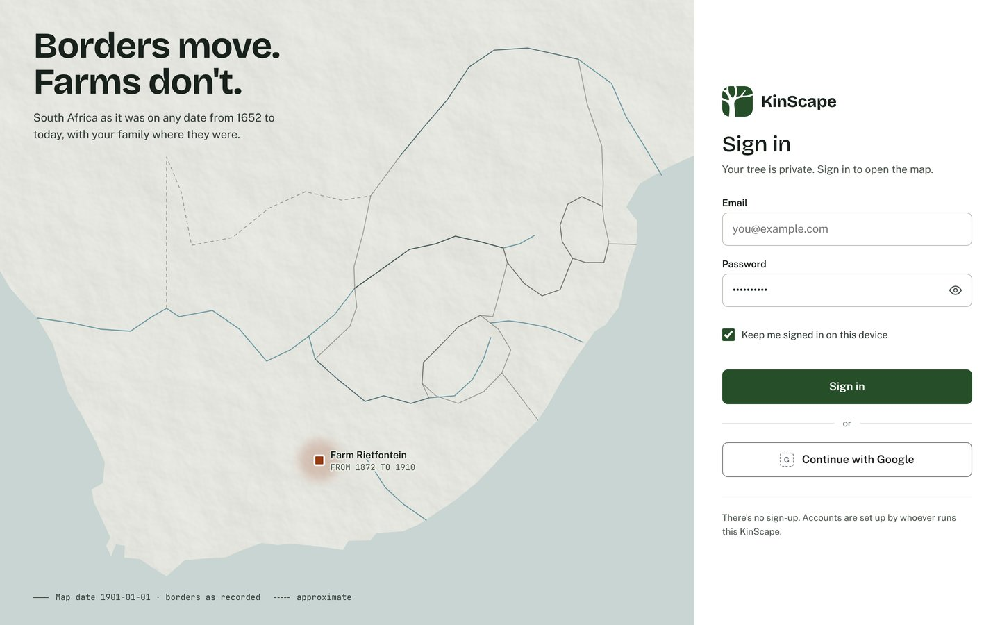
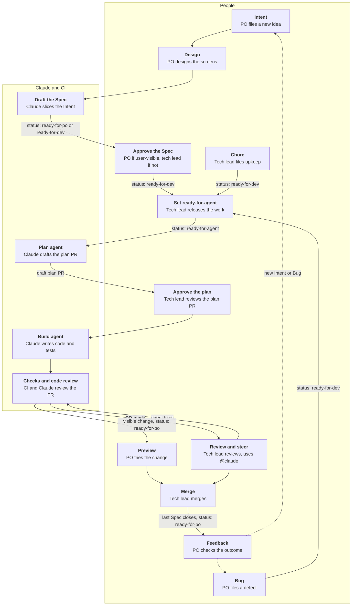

# KinScape

A time-travelling landscape for your kin. Drag the slider from 1652 to today and watch colonies, republics and provinces come and go, while great-great-oupa stays put on the family farm.

> Borders move. Places don't.

## Where things are

- **[How we work](docs/how-we-work.md)**: the workflow, labels and who does what. Start here.
- **[Requirements](docs/requirements.md)**: the baseline, with requirement IDs.
- **[Design](design/DESIGN.md)**: how things look, with mockups.
- **[Repository settings](docs/repo-settings.md)**: GitHub settings, kept as code.
- **[Issues](https://github.com/henetiriki/kinscape/issues)**: Intents, Specs and bugs.
- **[AGENTS.md](AGENTS.md)**: what AI agents read at the start of every session (`CLAUDE.md` imports it).

**_Design mockup, not the built app._**

Built as an experiment in the [AI-native SDLC](https://claude.com/resources/articles/the-ai-native-sdlc-playbook).

## How we work

Who acts at each stage and the `status:` label that hands it on. Detail: [how we work](docs/how-we-work.md). Every workflow: [workflows](.github/workflows/README.md).

## Contributions

This repo is a showcase: it takes no issues or pull requests from outside the team. To report a vulnerability, see [SECURITY.md](SECURITY.md).

## Licence

The code is [MIT](LICENSE). Third-party data keeps its own licences, listed in [`data/sources.json`](data/sources.json).
