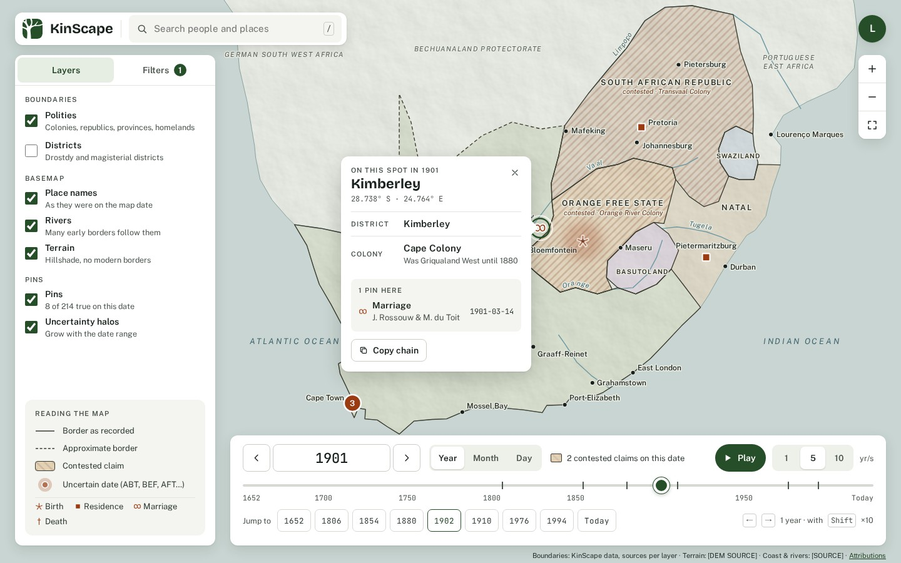

# KinScape design

The look of KinScape: fonts, colours, components and the map style. The JPGs in this folder are the reference screens. The design agent made them on the [design canvas](https://claude.ai/artifact/KNh9aZWeMNtsNSWtWLCbzU). [`docs/requirements.md`](../docs/requirements.md) holds behaviour. The [design system](https://claude.ai/artifact/3beQGzd1oHSga2LhPanAVi) holds the same tokens, fonts and icons for Claude.

## Screens

| Screen                                               | File                                                                               |
| ---------------------------------------------------- | ---------------------------------------------------------------------------------- |
| Sign in, desktop                                     | [sign-in-desktop.jpg](sign-in-desktop.jpg)                                         |
| Sign in, phone                                       | [sign-in-phone.jpg](sign-in-phone.jpg)                                             |
| Sign in, phone, wrong password                       | [sign-in-phone-error.jpg](sign-in-phone-error.jpg)                                 |
| Sign in, desktop, can't sign in right now            | [sign-in-unavailable.jpg](sign-in-unavailable.jpg)                                 |
| Sign in, phone, can't sign in right now              | [sign-in-phone-unavailable.jpg](sign-in-phone-unavailable.jpg)                     |
| Map, desktop, Layers tab, point clicked              | [map-desktop.jpg](map-desktop.jpg)                                                 |
| Map, desktop, Filters tab                            | [map-desktop-filters.jpg](map-desktop-filters.jpg)                                 |
| Map, phone, look-up only (NFR-05)                    | [map-phone.jpg](map-phone.jpg)                                                     |
| Map, phone, sheet collapsed                          | [map-phone-collapsed.jpg](map-phone-collapsed.jpg)                                 |
| Map, phone, Layers screen                            | [map-phone-layers.jpg](map-phone-layers.jpg)                                       |
| Map, phone, Filters                                  | [map-phone-filters.jpg](map-phone-filters.jpg)                                     |
| First load                                           | [map-loading.jpg](map-loading.jpg)                                                 |
| First load, phone                                    | [map-loading-phone.jpg](map-loading-phone.jpg)                                     |
| No pins in the tree                                  | [map-empty-tree.jpg](map-empty-tree.jpg)                                           |
| No pins in the tree, phone                           | [map-empty-tree-phone.jpg](map-empty-tree-phone.jpg)                               |
| No pins on this date                                 | [map-empty-date.jpg](map-empty-date.jpg)                                           |
| No pins on this date, phone                          | [map-empty-date-phone.jpg](map-empty-date-phone.jpg)                               |
| Districts layer on                                   | [map-districts.jpg](map-districts.jpg)                                             |
| Districts layer on, phone                            | [map-districts-phone.jpg](map-districts-phone.jpg)                                 |
| Terrain failed to load                               | [map-offline.jpg](map-offline.jpg)                                                 |
| Terrain failed to load, phone                        | [map-offline-phone.jpg](map-offline-phone.jpg)                                     |
| Account menu (M2)                                    | [map-account-menu.jpg](map-account-menu.jpg)                                       |
| Account menu, phone (M2)                             | [map-account-menu-phone.jpg](map-account-menu-phone.jpg)                           |
| Sources and attributions                             | [map-sources.jpg](map-sources.jpg)                                                 |
| Sources and attributions, phone                      | [map-sources-phone.jpg](map-sources-phone.jpg)                                     |
| Map style: MapLibre layer stack                      | [map-style.jpg](map-style.jpg)                                                     |
| Map style, phone                                     | [map-style-phone.jpg](map-style-phone.jpg)                                         |
| Invalid date typed in the dock                       | [map-date-invalid.jpg](map-date-invalid.jpg)                                       |
| Invalid date typed in the dock, phone                | [map-date-invalid-phone.jpg](map-date-invalid-phone.jpg)                           |
| Style guide 01: typography                           | [style-1-type.jpg](style-1-type.jpg)                                               |
| Style guide 01: typography, phone                    | [style-1-type-phone.jpg](style-1-type-phone.jpg)                                   |
| Style guide 02: colour                               | [style-2-colour.jpg](style-2-colour.jpg)                                           |
| Style guide 02: colour, phone                        | [style-2-colour-phone.jpg](style-2-colour-phone.jpg)                               |
| Style guide 03: spacing, shape, motion               | [style-3-foundations.jpg](style-3-foundations.jpg)                                 |
| Style guide 03: spacing, shape, motion, phone        | [style-3-foundations-phone.jpg](style-3-foundations-phone.jpg)                     |
| Style guide 04: component states                     | [style-4-states.jpg](style-4-states.jpg)                                           |
| Style guide 04: component states, phone              | [style-4-states-phone.jpg](style-4-states-phone.jpg)                               |
| Style guide 05: feedback and validation              | [style-5-feedback.jpg](style-5-feedback.jpg)                                       |
| Style guide 05: feedback and validation, phone       | [style-5-feedback-phone.jpg](style-5-feedback-phone.jpg)                           |
| Style guide 06: inputs and actions                   | [style-6-components-inputs.jpg](style-6-components-inputs.jpg)                     |
| Style guide 06: inputs and actions, phone, part 1    | [style-6-components-inputs-phone.jpg](style-6-components-inputs-phone.jpg)         |
| Style guide 06: inputs and actions, phone, part 2    | [style-6-components-inputs-2-phone.jpg](style-6-components-inputs-2-phone.jpg)     |
| Style guide 07: surfaces and overlays, part 1        | [style-7-components-surfaces.jpg](style-7-components-surfaces.jpg)                 |
| Style guide 07: surfaces and overlays, part 2        | [style-7-components-surfaces-2.jpg](style-7-components-surfaces-2.jpg)             |
| Style guide 07: surfaces and overlays, phone, part 1 | [style-7-components-surfaces-phone.jpg](style-7-components-surfaces-phone.jpg)     |
| Style guide 07: surfaces and overlays, phone, part 2 | [style-7-components-surfaces-2-phone.jpg](style-7-components-surfaces-2-phone.jpg) |
| Style guide 08: map furniture                        | [style-8-components-map.jpg](style-8-components-map.jpg)                           |
| Style guide 08: map furniture, phone, part 1         | [style-8-components-map-phone.jpg](style-8-components-map-phone.jpg)               |
| Style guide 08: map furniture, phone, part 2         | [style-8-components-map-2-phone.jpg](style-8-components-map-2-phone.jpg)           |
| Design kit index                                     | [design-kit.jpg](design-kit.jpg)                                                   |
| Design kit index, phone                              | [design-kit-phone.jpg](design-kit-phone.jpg)                                       |
| Design kit boards menu open, phone                   | [design-kit-menu-phone.jpg](design-kit-menu-phone.jpg)                             |
| Add a pin (provisional)                              | [add-pin.jpg](add-pin.jpg)                                                         |
| Add a pin, phone (provisional)                       | [add-pin-phone.jpg](add-pin-phone.jpg)                                             |
| People list                                          | [people-list.jpg](people-list.jpg)                                                 |
| People list, filter finds nothing                    | [people-list-no-match.jpg](people-list-no-match.jpg)                               |
| People list, no people yet                           | [people-empty.jpg](people-empty.jpg)                                               |
| People list, failed to load                          | [people-load-failed.jpg](people-load-failed.jpg)                                   |
| People list, phone, read-only                        | [people-list-phone.jpg](people-list-phone.jpg)                                     |
| Person form, add                                     | [person-new.jpg](person-new.jpg)                                                   |
| Person form, edit                                    | [person-edit.jpg](person-edit.jpg)                                                 |
| Person form, errors after Save                       | [person-errors.jpg](person-errors.jpg)                                             |
| Person form, save failed                             | [person-save-failed.jpg](person-save-failed.jpg)                                   |
| Person form, changed by another edit                 | [person-conflict.jpg](person-conflict.jpg)                                         |
| Person not found                                     | [person-not-found.jpg](person-not-found.jpg)                                       |
| Person form, phone, notice                           | [person-form-phone.jpg](person-form-phone.jpg)                                     |
| Fuzzy dates, readings and messages                   | [fuzzy-date-readings.jpg](fuzzy-date-readings.jpg)                                 |

People, pins and boundary shapes in the JPGs are illustrative, not data.

`npm run design:check` renders each screen in `screens.json` beside its HTML snapshot and ignores the map. It writes the differences to `test-results/design/`. Every screen is `blocking`: CI fails above the threshold.

[CANVAS.md](CANVAS.md) says how to refresh the canvas copy and make the snapshots and JPGs.

### Proposed screens

Not built. The sign-in rows and the first account menu rows show Google sign-in: see [Components](#components). The two People rows show the People entry in the account menu. M2.9.7 builds it and puts these rows in place of the built ones.

| Screen                                   | File                                                                       |
| ---------------------------------------- | -------------------------------------------------------------------------- |
| Sign in, desktop, proposed               | [sign-in-desktop-proposed.jpg](sign-in-desktop-proposed.jpg)               |
| Sign in, phone, proposed                 | [sign-in-phone-proposed.jpg](sign-in-phone-proposed.jpg)                   |
| Sign in, phone, wrong password, proposed | [sign-in-phone-error-proposed.jpg](sign-in-phone-error-proposed.jpg)       |
| Account menu, proposed                   | [map-account-menu-proposed.jpg](map-account-menu-proposed.jpg)             |
| Account menu, phone, proposed            | [map-account-menu-phone-proposed.jpg](map-account-menu-phone-proposed.jpg) |
| Account menu with People                 | [map-account-menu-people.jpg](map-account-menu-people.jpg)                 |
| Account menu with People, phone          | [map-account-menu-phone-people.jpg](map-account-menu-phone-people.jpg)     |

## Brand

- The name is **KinScape**, capital S, in UI text and docs.
- The icon is `app/icon0.svg`: a white tree on forest green, with a 25% corner radius. Never recolour it.
- Wordmark: the icon, then "KinScape" in Bricolage Grotesque 700.
- Tagline: "Borders move. Places don't."

## Fonts

| Font                | Weights                           | Used for                                                |
| ------------------- | --------------------------------- | ------------------------------------------------------- |
| Bricolage Grotesque | 500, 700                          | Wordmark, page titles, the place name in a popup        |
| Public Sans         | 400, 500, 600, italic 400 and 500 | All UI text and every map label                         |
| JetBrains Mono      | 400, 500                          | Dates, coordinates, keyboard hints, code. Ligatures off |

Components set these styles with `<Text variant>` (`app/components/foundation/Text.tsx`). `/design-kit/type` shows them.

All three are OFL fonts. The app and the snapshots load the same `@fontsource` files, pinned in `package-lock.json`. Map labels need Public Sans Regular, SemiBold and Italic as glyph PBFs too (see [Map style](#map-style)).

| Style    | Font · size / line · weight                | Used for                       |
| -------- | ------------------------------------------ | ------------------------------ |
| Display  | Bricolage 52 / 56 · 700 · tracking −0.02em | Sign-in headline               |
| H1       | Bricolage 32 / 40 · 500 · −0.015em         | Page title                     |
| H1 phone | Bricolage 28 / 32 · 500 · −0.015em         | Page title on a phone          |
| H2       | Bricolage 24 / 32 · 700                    | Dialog and section titles      |
| H3       | Bricolage 22 / 28 · 700                    | Place name in a popup, cards   |
| Title    | Public Sans 15 / 22 · 600                  | Notice titles, row titles      |
| Body L   | Public Sans 16 / 24 · 400                  | Sign-in, fields                |
| Body     | Public Sans 15 / 22 · 400                  | Panels, popups                 |
| Label    | Public Sans 14 / 20 · 600                  | Field labels, layer rows       |
| Small    | Public Sans 13 / 20 · 400, `--ink-3`       | Helper text                    |
| Caption  | Public Sans 12.5 / 18 · 400, `--ink-3`     | Credits, footnotes             |
| Overline | Public Sans 11 / 16 · 600, caps, 0.1em     | Section headings               |
| Button   | Public Sans 16 / 24 · 600                  | 50px buttons (sign-in)         |
| Control  | Public Sans 15 / 22 · 600                  | 44px buttons and controls      |
| Button S | Public Sans 14 / 20 · 600                  | 40px and 36px buttons          |
| Mono L   | JetBrains Mono 22 / 28 · 500               | Map date field                 |
| Mono     | JetBrains Mono 12 / 16 · 400               | Dates and coordinates in lists |

Line height is 1.1–1.25 for headings, 1.45–1.55 for sentences and 1.3–1.4 for one-line UI text. Keep running text under 68 characters a line. Set no body text below 12.5px and no map label below 11px.

The `kit.*` tokens set the design kit's board titles, page padding and intro width. Only kit pages use them.

## Colours

[`tokens.json`](tokens.json) holds every value (colours, type, spacing, radii, shadows, focus, motion and the map). `npm run tokens` writes it to `app/tokens.css` as CSS custom properties. Colours are `--brand` and `--ink-3`; other groups keep their group name (`--radius-panel`). Use a token, never its value. `/design-kit/colour` shows each colour with its value and contrast ratio. The `notes` group of `tokens.json` says where each token is used.

Text colours pass 4.5:1 on `--surface` and `--surface-2`. Each system text colour passes on its own background. Field borders, system borders and icons, and the focus ring pass 3:1. Colour never carries meaning alone: event types have shapes, the map hatches contested claims and dashes approximate borders (NFR-06).

## Layout

- Desktop first. The map fills the window and everything else floats on it with a 24px gutter.
- Desktop: search bar top left. The Layers / Filters panel sits below it, 320px wide. The date dock runs along the bottom, right of the panel. Account and zoom controls are top right. The credits line sits under the dock.
- Phone: search pill on top, a layers button under it, and a bottom sheet. When collapsed, the sheet holds only the date stepper and Play. When the user taps the map, the sheet opens with the look-up result. A user cannot edit on a phone.
- Sizes, offsets and stacking come from the `layout`, `breakpoint` and `z` tokens in `tokens.json`. A media query can't read a variable, so a test checks each against `breakpoint`.
- The `Stage` places the search, account, zoom, panel, dock, credits and overlay slots from those tokens. On a phone only, it also places a Layers button. Its overlay area runs from `dock-left` to the gutter and from `furniture-top` to the dock's top. A popup sits left of its map point (`popup-gap`, `popup-point-y`), with the pointer on its right edge.
- A notice centres in the free map area, not the window.
- `AuthLayout` places the sign-in hero and form from `layout.sign-in`. On desktop the hero is left, and the form pane is at least 440 wide with a form of at most 360. On a phone, a 188px hero with the wordmark over it comes first, then the form. `SignInHero`'s coast and border lines are a hand-drawn sketch, traced from no dataset (NFR-08).
- Pass MapLibre `padding` so the map centres in the space the panel and dock leave.

## Shape and depth

`/design-kit/foundations` shows these with spacing and motion.

| Token   | Value                                                                                                                             |
| ------- | --------------------------------------------------------------------------------------------------------------------------------- |
| Radius  | 8 buttons and fields · 12 panels, dock, popup · 18 top of phone sheet · pills fully round                                         |
| Shadow  | `--shadow-raised` for panels and the dock; `--shadow-floating` for popups; `--shadow-modal`, `--shadow-sheet`, `--shadow-segment` |
| Spacing | 4px steps; 16–20 inside panels, 24 between floating elements on desktop                                                           |
| Touch   | Targets at least 44px. Buttons and fields 44–50px tall                                                                            |
| Focus   | 2px `--focus-ring` outline, 2px offset, on `:focus-visible` only. Fields: see Text field                                          |

## Components

`docs/architecture.md` has the component-folder rule. Import a component as `@ks/app/components/<folder>/<Name>`. These folders hold the shared components:

| Folder       | Holds                                                                              |
| ------------ | ---------------------------------------------------------------------------------- |
| `foundation` | Text, Icon, Surface, Divider, focus, Avatar, Wordmark, PageHeader                  |
| `actions`    | Button, IconButton, TextLink, Chip, ChipGroup, Segmented, Tabs, KeyHint, ActionBar |
| `forms`      | TextField, SelectField, TokenField, Checkbox, CheckboxField                        |
| `feedback`   | Alert, Banner, Toast, NoticeCard, ProgressBar, Callout                             |
| `overlays`   | Modal, Dialog, Sheet, BottomSheet, Menu, Popup                                     |
| `auth`       | What only sign-in uses: AuthLayout, SignInHero, SignInForm                         |

**Page rule.** A screen's Spec names the components it needs and lists any that are missing under **Flagged concerns**. A page composes components: it has no stylesheet or `className` of its own. If other pages reuse a part, or it has states of its own, make it a component. Never build it inside a page. The dev-only `app/design-kit` and `app/screens` are exempt.

- **Buttons:** by height. L 50 (sign-in, full width): `type.button`. M 44: `type.control`, padding 16. S 40: `type.button-s`, padding 16. XS 36: `type.button-s`, padding 12.
- **Primary button:** `--brand` fill, white text.
- **Secondary button:** white, 1px `--line-strong` border, `--ink` text. With an `href`, a button is a plain link with the same look and states, and it has no disabled state.
- **Page header:** a 64px white bar (60px on a phone) with a bottom `--line` border. It holds the Wordmark (icon only on a phone), a divider, the back link and the Avatar at the right.
- **Back link:** a 44px link with the back icon and the name of the page above. It takes its hover, focus and pressed looks from the icon button.
- **Action bar:** a 72px white bar fixed to the bottom of the window, with a top `--line` border. It holds the primary button, then the secondary one. On a phone it adds the safe area of the device below the 72px.
- **Google sign-in (proposed):** not in the requirements yet. Before you build it, file an Intent issue. It goes under "Sign in", after an "or" divider. White, 1px `--google-border` border, `--google-text` text, "Continue with Google". Use Google's own button or the official "G" mark, never a redrawn one. The dashed box in the JPG marks the spot. If Google sign-in is off, hide the button and the divider.
- **Text field:** M 44px with `type.body` (`type.body-l` on phones); L 48px with `type.body-l` on sign-in; 1px `--field-border`, radius 8. Hover: `--ink-3` border. Focus: 2px `--brand` border, no outline. Error: see [Feedback and validation](#feedback-and-validation). Clear the password after a failed sign-in.
- **Segmented control** (date precision, play speed): a `--segment` track; the selected segment is white with a small shadow.
- **Chips** (event type filters): 36px pills. On: `--brand` border, `--brand-tint` fill. Off: `--line-strong` border, white.
- **Tabs** (Layers / Filters): the selected tab gets `--brand-tint`. A count badge in `--brand` shows active filters.
- **Layer rows:** a checkbox (accent `--brand`), name 14/600, a one-line description in `--ink-3`. The description gives live facts, such as how many pins are true on the date.
- **Date dock:** step back, a typed date field, step forward, Year / Month / Day, a contested-claims note and Play with 1, 5 or 10 yr/s. Under that is the 1652–today slider with epoch ticks and the contested years hatched. The thumb snaps to each step at the chosen precision. The date field is the only date readout. Then "Jump to" epoch buttons and keyboard hints.
- **Phone date sheet:** a non-modal bottom sheet, 152px collapsed and 432px expanded, with a grabber ("Expand the sheet"). Collapsed: the stepper around the date field and a round Play. Expanded adds the slider. No precision, speed, Jump to or hints.
- **Jurisdiction popup:** "On this spot in {year}", the place name valid on that date, coordinates in mono, then the jurisdiction chain as level / name rows, then pins at that spot.
- **Notice card:** white card with the panel shadow, an icon, a 15/600 title and one line of help, plus up to two buttons. A button can be a link. It shows empty and loading states.
- **Banner:** `--ink` background, white text, top centre of the map, with one action. For problems that don't block the map.
- **Menu:** white card, popup shadow, 44px rows with an icon.
- **Dialog:** centred over a `--scrim`, radius 12, close button top right.
- **Alert:** 1px system border, system background and text, padding 12 16, gap 12, a filled 20px icon, a 14/600 title and one line in `type.small`.
- **Toast:** white, popup shadow, bottom centre above the dock. A success toast leaves after 4 seconds. An error toast stays and offers a retry.

Every control has the five states in [style-4-states.jpg](style-4-states.jpg). Hover darkens or tints. Pressed goes a step darker (`--brand-pressed`, or `--brand-tint` for secondary controls). Disabled uses `--ink-disabled` on `--line` or `--surface-2`. Toggles keep their "on" look after release. Nothing important appears only on hover.

`/design-kit/states` builds the controls. `/design-kit` lists the boards. In production the kit is a 404.

## States

| State                | Design                                                                                                                                                                            |
| -------------------- | --------------------------------------------------------------------------------------------------------------------------------------------------------------------------------- |
| First load (NFR-02)  | Panel and date dock render at once from the URL. The map area shows a "Loading the map" card with a progress bar. A date change never shows a loader (NFR-01).                    |
| No pins in the tree  | A notice card in the middle of the map. The map still works as an atlas. No add button until data entry is designed.                                                              |
| No pins on this date | A notice card at the top reads "No pins in {year}" and "Jump to {nearest year}". When filters are on, it also has "Clear filters". The Pins row reads "0 of N true on this date". |
| Districts on         | Thin district lines under polity borders. Where coverage is partial, the Districts row says where (e.g. "On this date: Cape Colony only").                                        |
| Terrain failed       | A banner with Retry. Borders and pins keep working because they load up front.                                                                                                    |
| Account menu         | Signed-in email, Export all data (JSON and GeoJSON, NFR-04), Sources and attributions, Sign out, and the last backup time (Export, backup time: M3).                              |
| Phone, collapsed     | Date stepper and Play only, and a hint to tap the map.                                                                                                                            |

## Feedback and validation

Errors block until fixed, warnings don't, success confirms something finished, and info explains something the app did. Each one has an icon and words. Where it goes:

- **A field's problem:** next to the field, in place of its helper text.
- **A problem with one part of the screen:** an alert in that part, such as a failed sign-in above the form.
- **The result of an action:** a toast.
- **A problem with the app:** a banner.

Errors use `role="alert"`. Everything else uses `role="status"`.

### Map date field

`/design-kit/feedback` shows it. The field is 188px wide and accepts `1901`, `1901-06` or `1901-06-14`. The field pads single digits (`1901-6-4`).

1. Check on Enter or when focus leaves, never while the user types.
2. When the date is invalid, keep what was typed. Show a 2px `--error-border` and an error icon inside the field. Set `aria-invalid`. Link the message with `aria-describedby`.
3. In the dock, the message opens 12px above the dock's top edge and points at the field. It is 340px wide from the Back button. On a phone it is the sheet's full width and may cover the credits line. Everywhere else it goes below the field.
4. The map, slider and URL stay on the last good date, and the message names it.
5. Esc restores the last good date. The slider, step buttons and Jump to buttons also clear the error.
6. A good date gets no success styling: the map moving is the confirmation.

| Case                    | Message                                        | Fix offered              |
| ----------------------- | ---------------------------------------------- | ------------------------ |
| Wrong format            | Use 1901, 1901-06 or 1901-06-14.               |                          |
| Before 1652             | Dates run from 1652 to today.                  | Go to 1652               |
| After today             | That's after today.                            | Go to today              |
| Doesn't exist           | February 1901 has 28 days.                     | Go to the last valid day |
| No borders for the date | No borders are mapped for 1750 yet. (warning)  |                          |
| More precise than set   | Switched to month precision. (info, 4 seconds) |                          |

## Attributions

NFR-08 requires the app to credit every source. The design fixes the format. The licence checks (NFR-08, BND-06) supply the text.

- One sources file in the repo lists each source: layer, title, author, licence, licence link, attribution text and the date of the check. After you check its licence, add a source to the map.
- The credits line under the date dock joins the attribution text of the sources on screen with " · " and ends with an "Attributions" link. 11px, `--credits`.
- The "Sources and attributions" dialog opens from that link or the account menu. It lists every source as layer, source (with its detail line), licence and date checked.
- The JPGs show `[Source]` and `[Licence]` until someone completes the checks. Do not replace them with guesses.

## Event glyphs

Each Event type is one 24 × 24 path in `design/source/`. It uses `currentColor` (`--pin`) as its fill and is 1em square. The order below is the same everywhere. `EventGlyph` copies the paths. A test keeps them in step.

| Event      | SVG                           |
| ---------- | ----------------------------- |
| Birth      | `kse-birth.svg`               |
| Baptism    | `kse-baptism-christening.svg` |
| Residence  | `kse-residence.svg`           |
| Marriage   | `kse-marriage.svg`            |
| Divorce    | `kse-divorce.svg`             |
| Death      | `kse-death.svg`               |
| Burial     | `kse-burial.svg`              |
| Land       | `kse-land.svg`                |
| Occupation | `kse-occupation.svg`          |
| Other      | `kse-other.svg`               |

On the map these are SDF icons in `--pin`, with a 2px white halo.

## Map style

Every map visual is something MapLibre GL can draw: flat fills, solid or dashed lines, one `fill-pattern` hatch, a hillshade layer, circles and SDF symbols. [map-style.jpg](map-style.jpg) shows the full layer stack, and `/design-kit/map-style` builds it. The map colours:

| Use                     | Value                                                                                               |
| ----------------------- | --------------------------------------------------------------------------------------------------- |
| Sea (background)        | `map.sea`                                                                                           |
| Land                    | `map.land`                                                                                          |
| Coastline               | `map.coastline`                                                                                     |
| Rivers                  | `map.river`, wider with zoom                                                                        |
| Polity border           | `map.border`; dashed when confidence is low                                                         |
| District border         | `map.district`                                                                                      |
| Changed border (MAP-11) | `map.changed` (`--brand`), fades out                                                                |
| Polity fills            | `map.polity`, keyed by Polity id; `default` for any other (muted tints of similar lightness)        |
| Contested hatch         | 45° stripes, 3px in 9px, `map.hatch`                                                                |
| Hillshade               | `map.hillshade`                                                                                     |
| Polity label            | Public Sans SemiBold, uppercase; `map.polity-label`; contested note in italic `map.contested-label` |
| Place label             | Public Sans Medium; `map.place-label`; dot `map.place-dot`                                          |
| Water and river labels  | Public Sans Italic; `map.water-label`, `map.river-label`; sizes in tokens                           |
| Context labels          | Public Sans Italic, uppercase, `map.context-label`                                                  |
| Label halo              | `map.label-halo`, the land colour                                                                   |
| Uncertainty halo        | `map.pin-halo`; radius grows with the date range                                                    |
| Selected point          | `map.selected` (`--brand`)                                                                          |

Avoid what MapLibre can't do: shadows, glows or gradients on polygons, dashed circle outlines, and boxes behind labels. Anything you click or type into is HTML over the map.

## Copy

- Use the requirements' Key concepts terms (Map date, Pin, Polity, Jurisdiction chain).
- Sentence case everywhere, except map labels for polities and context areas.
- Names on the map are the names valid on the map date (MAP-06).
- No sign-up wording. The sign-in page says whoever runs KinScape creates accounts.

## Not designed yet

These have no design: see `AGENTS.md`.

- The screens that add or edit relationships, pins and sources. "Add a pin" is provisional: plain Person and Place fields, no date qualifiers. `/screens/add-pin` builds it to prove the export.
- The popup for a click inside a contested area: how it shows both claims (BND-04, MAP-07).
- Search results (EXP-04).
- Person panel, life trail and migration view (EXP-05 to EXP-07).
- The changed-border flash (MAP-11).
- The view that compares two dates (MAP-12).
- Pin warnings (PIN-08) and source records on the map (PIN-07).
- Tablet layout (NFR-05).
