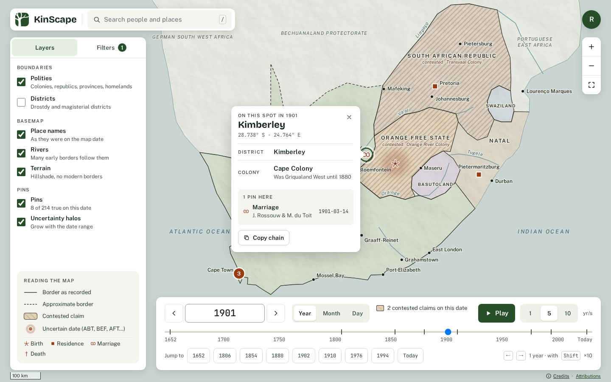

# KinScape design

The look of KinScape: fonts, colours, components and the map style. The JPGs in this folder are the reference screens from the [design canvas](https://claude.ai/artifact/KNh9aZWeMNtsNSWtWLCbzU). [`docs/requirements.md`](../docs/requirements.md) holds behaviour. The [design system](https://claude.ai/artifact/3beQGzd1oHSga2LhPanAVi) holds the same tokens, fonts and icons for Claude.

## Design files

Each file in `design/topics/` has `paths:` frontmatter. `npm run plan:new` lists the files whose paths match an issue. These are not `.claude/rules/` files. CI edits them, and CI never edits a rule file: it is a [hand-back path](../plans/README.md#hand-back).

- [foundations.md](topics/foundations.md): Brand, Fonts, Colours, Shape and depth, Motion.
- [layout.md](topics/layout.md): Layout.
- [components.md](topics/components.md): In the repo, Components.
- [feedback.md](topics/feedback.md): States, Feedback and validation.
- [map.md](topics/map.md): Event glyphs, Map style, Attributions.
- [tokens.md](topics/tokens.md): how a token value travels. The design system does not read it.

## Screens

| Screen                                            | File                                                                         |
| ------------------------------------------------- | ---------------------------------------------------------------------------- |
| Sign in, desktop                                  | [sign-in-desktop.jpg](sign-in-desktop.jpg)                                   |
| Sign in, phone                                    | [sign-in-phone.jpg](sign-in-phone.jpg)                                       |
| Sign in, phone, wrong password                    | [sign-in-phone-error.jpg](sign-in-phone-error.jpg)                           |
| Sign in, desktop, can't sign in right now         | [sign-in-unavailable.jpg](sign-in-unavailable.jpg)                           |
| Sign in, phone, can't sign in right now           | [sign-in-phone-unavailable.jpg](sign-in-phone-unavailable.jpg)               |
| Map, desktop, Layers tab, point clicked           | [map-desktop.jpg](map-desktop.jpg)                                           |
| Map, desktop, Filters tab                         | [map-desktop-filters.jpg](map-desktop-filters.jpg)                           |
| Map, phone, look-up only (NFR-05)                 | [map-phone.jpg](map-phone.jpg)                                               |
| Map, phone, sheet collapsed                       | [map-phone-collapsed.jpg](map-phone-collapsed.jpg)                           |
| Map, phone, Layers screen                         | [map-phone-layers.jpg](map-phone-layers.jpg)                                 |
| Map, phone, Filters                               | [map-phone-filters.jpg](map-phone-filters.jpg)                               |
| First load                                        | [map-loading.jpg](map-loading.jpg)                                           |
| First load, phone                                 | [map-loading-phone.jpg](map-loading-phone.jpg)                               |
| No pins in the tree                               | [map-empty-tree.jpg](map-empty-tree.jpg)                                     |
| No pins in the tree, phone                        | [map-empty-tree-phone.jpg](map-empty-tree-phone.jpg)                         |
| No pins on this date                              | [map-empty-date.jpg](map-empty-date.jpg)                                     |
| No pins on this date, phone                       | [map-empty-date-phone.jpg](map-empty-date-phone.jpg)                         |
| Districts layer on                                | [map-districts.jpg](map-districts.jpg)                                       |
| Districts layer on, phone                         | [map-districts-phone.jpg](map-districts-phone.jpg)                           |
| Terrain failed to load                            | [map-offline.jpg](map-offline.jpg)                                           |
| Terrain failed to load, phone                     | [map-offline-phone.jpg](map-offline-phone.jpg)                               |
| Account menu (M2)                                 | [map-account-menu.jpg](map-account-menu.jpg)                                 |
| Account menu, phone (M2)                          | [map-account-menu-phone.jpg](map-account-menu-phone.jpg)                     |
| Sources and attributions                          | [map-sources.jpg](map-sources.jpg)                                           |
| Sources and attributions, phone                   | [map-sources-phone.jpg](map-sources-phone.jpg)                               |
| Credits at 800px, collapsed                       | [map-credits-narrow.jpg](map-credits-narrow.jpg)                             |
| Credits at 800px, expanded                        | [map-credits-narrow-open.jpg](map-credits-narrow-open.jpg)                   |
| Map style: MapLibre layer stack                   | [map-style.jpg](map-style.jpg)                                               |
| Map style, phone                                  | [map-style-phone.jpg](map-style-phone.jpg)                                   |
| Invalid date typed in the dock                    | [map-date-invalid.jpg](map-date-invalid.jpg)                                 |
| Invalid date typed in the dock, phone             | [map-date-invalid-phone.jpg](map-date-invalid-phone.jpg)                     |
| Pins, count marker and its four looks             | [map-pin-count.jpg](map-pin-count.jpg)                                       |
| Pins, fan-out, one Pin under hover                | [map-pin-fan.jpg](map-pin-fan.jpg)                                           |
| Pins, fan-out, phone, after the first tap         | [map-pin-fan-phone.jpg](map-pin-fan-phone.jpg)                               |
| Pin popup                                         | [map-pin-popup.jpg](map-pin-popup.jpg)                                       |
| Pin popup, details loading                        | [map-pin-popup-loading.jpg](map-pin-popup-loading.jpg)                       |
| Pin popup, details did not load                   | [map-pin-popup-failed.jpg](map-pin-popup-failed.jpg)                         |
| Pin popup, phone sheet                            | [map-pin-popup-phone.jpg](map-pin-popup-phone.jpg)                           |
| Add a pin, the map with the button                | [map-add-pin.jpg](map-add-pin.jpg)                                           |
| Add a pin, click popup                            | [pin-click-popup.jpg](pin-click-popup.jpg)                                   |
| Add a pin, empty panel                            | [pin-form-empty.jpg](pin-form-empty.jpg)                                     |
| Add a pin, panel filled after a click             | [pin-form.jpg](pin-form.jpg)                                                 |
| Add a pin, field errors                           | [pin-form-errors.jpg](pin-form-errors.jpg)                                   |
| Add a pin, Place fixed                            | [pin-form-existing-place.jpg](pin-form-existing-place.jpg)                   |
| Add a pin, saving                                 | [pin-form-saving.jpg](pin-form-saving.jpg)                                   |
| Add a pin, save failed                            | [pin-form-save-failed.jpg](pin-form-save-failed.jpg)                         |
| Add a pin, no people in the Tree                  | [pin-form-no-people.jpg](pin-form-no-people.jpg)                             |
| Edit a pin                                        | [pin-edit.jpg](pin-edit.jpg)                                                 |
| Edit a pin, point moved                           | [pin-edit-moved.jpg](pin-edit-moved.jpg)                                     |
| Edit a pin, loading                               | [pin-edit-loading.jpg](pin-edit-loading.jpg)                                 |
| Edit a pin, did not load                          | [pin-edit-load-failed.jpg](pin-edit-load-failed.jpg)                         |
| People list                                       | [people-list.jpg](people-list.jpg)                                           |
| People list, filter finds nothing                 | [people-list-no-match.jpg](people-list-no-match.jpg)                         |
| People list, no people yet                        | [people-empty.jpg](people-empty.jpg)                                         |
| People list, failed to load                       | [people-load-failed.jpg](people-load-failed.jpg)                             |
| People list, loading                              | [people-loading.jpg](people-loading.jpg)                                     |
| People list, loading, phone                       | [people-loading-phone.jpg](people-loading-phone.jpg)                         |
| People list, phone, read-only                     | [people-list-phone.jpg](people-list-phone.jpg)                               |
| Person form, add                                  | [person-new.jpg](person-new.jpg)                                             |
| Person form, edit                                 | [person-edit.jpg](person-edit.jpg)                                           |
| Person form, errors after Save                    | [person-errors.jpg](person-errors.jpg)                                       |
| Person form, save failed                          | [person-save-failed.jpg](person-save-failed.jpg)                             |
| Person form, changed by another edit              | [person-conflict.jpg](person-conflict.jpg)                                   |
| Person not found                                  | [person-not-found.jpg](person-not-found.jpg)                                 |
| Person form, phone, notice                        | [person-form-phone.jpg](person-form-phone.jpg)                               |
| Fuzzy dates, readings and messages                | [fuzzy-date-readings.jpg](fuzzy-date-readings.jpg)                           |
| Type scale, three ratios (proposal)               | [type-scale.jpg](type-scale.jpg)                                             |
| Spacing and controls, three ratios (proposal)     | [spacing-and-controls.jpg](spacing-and-controls.jpg)                         |
| Shapes, rounding and borders (proposal)           | [shapes.jpg](shapes.jpg)                                                     |
| Relationships, page, three groups                 | [person-relationships.jpg](person-relationships.jpg)                         |
| Relationships, no links yet                       | [person-relationships-empty.jpg](person-relationships-empty.jpg)             |
| Relationships, failed to load                     | [person-relationships-load-failed.jpg](person-relationships-load-failed.jpg) |
| Relationship dialog, step 1, pick a person        | [relationship-pick.jpg](relationship-pick.jpg)                               |
| Relationship dialog, step 1, filter finds nothing | [relationship-pick-no-match.jpg](relationship-pick-no-match.jpg)             |
| Relationship dialog, step 1, no other person      | [relationship-pick-empty.jpg](relationship-pick-empty.jpg)                   |
| Relationship dialog, step 2, parent               | [relationship-details-parent.jpg](relationship-details-parent.jpg)           |
| Relationship dialog, step 2, spouse               | [relationship-details-spouse.jpg](relationship-details-spouse.jpg)           |
| Relationship dialog, edit a spouse link           | [relationship-edit-spouse.jpg](relationship-edit-spouse.jpg)                 |
| Relationship dialog, cycle refused                | [relationship-cycle.jpg](relationship-cycle.jpg)                             |
| Relationship dialog, save failed                  | [relationship-save-failed.jpg](relationship-save-failed.jpg)                 |
| Relationship messages                             | [relationship-messages.jpg](relationship-messages.jpg)                       |
| Person form, edit, leave warning                  | [person-edit-leave.jpg](person-edit-leave.jpg)                               |

People, pins and boundary shapes in the JPGs are illustrative, not data.

`npm run design:check` renders each screen in `screens.json` beside its HTML snapshot and ignores the map. It writes the differences to `test-results/design/`. Every screen is `blocking`: CI fails above the threshold. It also opens each screen at 200% root text size, and CI fails on a failure that is not on the list: see [Units](topics/tokens.md#units).

[CANVAS.md](CANVAS.md) gives the path for a design. It also says how to refresh the canvas copy and make the snapshots and JPGs.

### Proposed screens

Not built. The sign-in rows show Google sign-in: see [Components](topics/components.md#components). The account menu rows show "Export all data" and the last backup time (M3).

| Screen                                   | File                                                                       |
| ---------------------------------------- | -------------------------------------------------------------------------- |
| Sign in, desktop, proposed               | [sign-in-desktop-proposed.jpg](sign-in-desktop-proposed.jpg)               |
| Sign in, phone, proposed                 | [sign-in-phone-proposed.jpg](sign-in-phone-proposed.jpg)                   |
| Sign in, phone, wrong password, proposed | [sign-in-phone-error-proposed.jpg](sign-in-phone-error-proposed.jpg)       |
| Account menu, proposed                   | [map-account-menu-proposed.jpg](map-account-menu-proposed.jpg)             |
| Account menu, phone, proposed            | [map-account-menu-phone-proposed.jpg](map-account-menu-phone-proposed.jpg) |

## Copy

- Use the requirements' Key concepts terms (Map date, Pin, Polity, Jurisdiction chain).
- Sentence case everywhere, except map labels for polities and context areas.
- Names on the map are the names valid on the map date (MAP-06).
- No sign-up wording. The sign-in page says whoever runs KinScape creates accounts.

## Not designed yet

These have no design: see `AGENTS.md`.

- The screens that add or edit sources.
- The popup for a click inside a contested area: how it shows both claims (BND-04, MAP-07).
- Search results (EXP-04).
- Person panel, life trail and migration view (EXP-05 to EXP-07).
- The changed-border flash (MAP-11).
- The view that compares two dates (MAP-12).
- Pin warnings (PIN-08) and source records on the map (PIN-07).
- Tablet layout (NFR-05).
