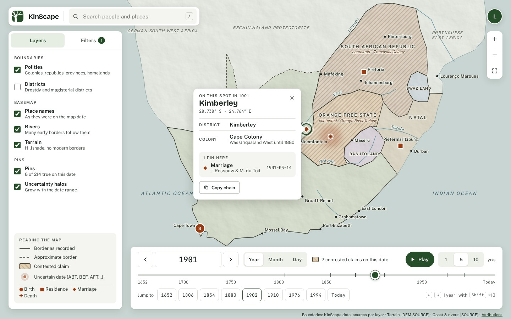

# KinScape design

The look of KinScape: fonts, colours, components and the map style. The screenshots in this folder are the reference mockups, designed with Claude Design on the [design canvas](https://claude.ai/artifact/KNh9aZWeMNtsNSWtWLCbzU). Behaviour lives in [`docs/requirements.md`](../docs/requirements.md); this file only covers how things look. The [design system](https://claude.ai/artifact/3beQGzd1oHSga2LhPanAVi) holds the same tokens, fonts and icons for Claude.

## Screens

| Screen                                               | File                                                                               | Source                                                                                      |
| ---------------------------------------------------- | ---------------------------------------------------------------------------------- | ------------------------------------------------------------------------------------------- |
| Sign in, desktop                                     | [sign-in-desktop.jpg](sign-in-desktop.jpg)                                         | [sign-in-desktop.html](source/sign-in-desktop.html)                                         |
| Sign in, phone                                       | [sign-in-phone.jpg](sign-in-phone.jpg)                                             | [sign-in-phone.html](source/sign-in-phone.html)                                             |
| Sign in, phone, wrong password                       | [sign-in-phone-error.jpg](sign-in-phone-error.jpg)                                 | [sign-in-phone-error.html](source/sign-in-phone-error.html)                                 |
| Map, desktop, Layers tab, point clicked              | [map-desktop.jpg](map-desktop.jpg)                                                 | [map-desktop.html](source/map-desktop.html)                                                 |
| Map, desktop, Filters tab                            | [map-desktop-filters.jpg](map-desktop-filters.jpg)                                 | [map-desktop-filters.html](source/map-desktop-filters.html)                                 |
| Map, phone, look-up only (NFR-05)                    | [map-phone.jpg](map-phone.jpg)                                                     | [map-phone.html](source/map-phone.html)                                                     |
| Map, phone, sheet collapsed                          | [map-phone-collapsed.jpg](map-phone-collapsed.jpg)                                 | [map-phone-collapsed.html](source/map-phone-collapsed.html)                                 |
| Map, phone, Layers screen                            | [map-phone-layers.jpg](map-phone-layers.jpg)                                       | [map-phone-layers.html](source/map-phone-layers.html)                                       |
| Map, phone, Filters                                  | [map-phone-filters.jpg](map-phone-filters.jpg)                                     | [map-phone-filters.html](source/map-phone-filters.html)                                     |
| First load                                           | [map-loading.jpg](map-loading.jpg)                                                 | [map-loading.html](source/map-loading.html)                                                 |
| First load, phone                                    | [map-loading-phone.jpg](map-loading-phone.jpg)                                     | [map-loading-phone.html](source/map-loading-phone.html)                                     |
| No pins in the tree                                  | [map-empty-tree.jpg](map-empty-tree.jpg)                                           | [map-empty-tree.html](source/map-empty-tree.html)                                           |
| No pins in the tree, phone                           | [map-empty-tree-phone.jpg](map-empty-tree-phone.jpg)                               | [map-empty-tree-phone.html](source/map-empty-tree-phone.html)                               |
| No pins on this date                                 | [map-empty-date.jpg](map-empty-date.jpg)                                           | [map-empty-date.html](source/map-empty-date.html)                                           |
| No pins on this date, phone                          | [map-empty-date-phone.jpg](map-empty-date-phone.jpg)                               | [map-empty-date-phone.html](source/map-empty-date-phone.html)                               |
| Districts layer on                                   | [map-districts.jpg](map-districts.jpg)                                             | [map-districts.html](source/map-districts.html)                                             |
| Districts layer on, phone                            | [map-districts-phone.jpg](map-districts-phone.jpg)                                 | [map-districts-phone.html](source/map-districts-phone.html)                                 |
| Terrain failed to load                               | [map-offline.jpg](map-offline.jpg)                                                 | [map-offline.html](source/map-offline.html)                                                 |
| Terrain failed to load, phone                        | [map-offline-phone.jpg](map-offline-phone.jpg)                                     | [map-offline-phone.html](source/map-offline-phone.html)                                     |
| Account menu                                         | [map-account-menu.jpg](map-account-menu.jpg)                                       | [map-account-menu.html](source/map-account-menu.html)                                       |
| Account menu, phone                                  | [map-account-menu-phone.jpg](map-account-menu-phone.jpg)                           | [map-account-menu-phone.html](source/map-account-menu-phone.html)                           |
| Sources and attributions                             | [map-sources.jpg](map-sources.jpg)                                                 | [map-sources.html](source/map-sources.html)                                                 |
| Sources and attributions, phone                      | [map-sources-phone.jpg](map-sources-phone.jpg)                                     | [map-sources-phone.html](source/map-sources-phone.html)                                     |
| Map style: MapLibre layer stack                      | [map-style.jpg](map-style.jpg)                                                     | [map-style.html](source/map-style.html)                                                     |
| Map style, phone                                     | [map-style-phone.jpg](map-style-phone.jpg)                                         | [map-style-phone.html](source/map-style-phone.html)                                         |
| Invalid date typed in the dock                       | [map-date-invalid.jpg](map-date-invalid.jpg)                                       | [map-date-invalid.html](source/map-date-invalid.html)                                       |
| Invalid date typed in the dock, phone                | [map-date-invalid-phone.jpg](map-date-invalid-phone.jpg)                           | [map-date-invalid-phone.html](source/map-date-invalid-phone.html)                           |
| Style guide 01: typography                           | [style-1-type.jpg](style-1-type.jpg)                                               | [style-1-type.html](source/style-1-type.html)                                               |
| Style guide 01: typography, phone                    | [style-1-type-phone.jpg](style-1-type-phone.jpg)                                   | [style-1-type-phone.html](source/style-1-type-phone.html)                                   |
| Style guide 02: colour                               | [style-2-colour.jpg](style-2-colour.jpg)                                           | [style-2-colour.html](source/style-2-colour.html)                                           |
| Style guide 02: colour, phone                        | [style-2-colour-phone.jpg](style-2-colour-phone.jpg)                               | [style-2-colour-phone.html](source/style-2-colour-phone.html)                               |
| Style guide 03: spacing, shape, motion               | [style-3-foundations.jpg](style-3-foundations.jpg)                                 | [style-3-foundations.html](source/style-3-foundations.html)                                 |
| Style guide 03: spacing, shape, motion, phone        | [style-3-foundations-phone.jpg](style-3-foundations-phone.jpg)                     | [style-3-foundations-phone.html](source/style-3-foundations-phone.html)                     |
| Style guide 04: component states                     | [style-4-states.jpg](style-4-states.jpg)                                           | [style-4-states.html](source/style-4-states.html)                                           |
| Style guide 04: component states, phone              | [style-4-states-phone.jpg](style-4-states-phone.jpg)                               | [style-4-states-phone.html](source/style-4-states-phone.html)                               |
| Style guide 05: feedback and validation              | [style-5-feedback.jpg](style-5-feedback.jpg)                                       | [style-5-feedback.html](source/style-5-feedback.html)                                       |
| Style guide 05: feedback and validation, phone       | [style-5-feedback-phone.jpg](style-5-feedback-phone.jpg)                           | [style-5-feedback-phone.html](source/style-5-feedback-phone.html)                           |
| Style guide 06: inputs and actions                   | [style-6-components-inputs.jpg](style-6-components-inputs.jpg)                     | [style-6-components-inputs.html](source/style-6-components-inputs.html)                     |
| Style guide 06: inputs and actions, phone, part 1    | [style-6-components-inputs-phone.jpg](style-6-components-inputs-phone.jpg)         | [style-6-components-inputs-phone.html](source/style-6-components-inputs-phone.html)         |
| Style guide 06: inputs and actions, phone, part 2    | [style-6-components-inputs-2-phone.jpg](style-6-components-inputs-2-phone.jpg)     | [style-6-components-inputs-2-phone.html](source/style-6-components-inputs-2-phone.html)     |
| Style guide 07: surfaces and overlays, part 1        | [style-7-components-surfaces.jpg](style-7-components-surfaces.jpg)                 | [style-7-components-surfaces.html](source/style-7-components-surfaces.html)                 |
| Style guide 07: surfaces and overlays, part 2        | [style-7-components-surfaces-2.jpg](style-7-components-surfaces-2.jpg)             | [style-7-components-surfaces-2.html](source/style-7-components-surfaces-2.html)             |
| Style guide 07: surfaces and overlays, phone, part 1 | [style-7-components-surfaces-phone.jpg](style-7-components-surfaces-phone.jpg)     | [style-7-components-surfaces-phone.html](source/style-7-components-surfaces-phone.html)     |
| Style guide 07: surfaces and overlays, phone, part 2 | [style-7-components-surfaces-2-phone.jpg](style-7-components-surfaces-2-phone.jpg) | [style-7-components-surfaces-2-phone.html](source/style-7-components-surfaces-2-phone.html) |
| Style guide 08: map furniture                        | [style-8-components-map.jpg](style-8-components-map.jpg)                           | [style-8-components-map.html](source/style-8-components-map.html)                           |
| Style guide 08: map furniture, phone, part 1         | [style-8-components-map-phone.jpg](style-8-components-map-phone.jpg)               | [style-8-components-map-phone.html](source/style-8-components-map-phone.html)               |
| Style guide 08: map furniture, phone, part 2         | [style-8-components-map-2-phone.jpg](style-8-components-map-2-phone.jpg)           | [style-8-components-map-2-phone.html](source/style-8-components-map-2-phone.html)           |
| Design kit index                                     | [design-kit.jpg](design-kit.jpg)                                                   | [design-kit.html](source/design-kit.html)                                                   |
| Design kit index, phone                              | [design-kit-phone.jpg](design-kit-phone.jpg)                                       | [design-kit-phone.html](source/design-kit-phone.html)                                       |
| Design kit boards menu open, phone                   | [design-kit-menu-phone.jpg](design-kit-menu-phone.jpg)                             | [design-kit-menu-phone.html](source/design-kit-menu-phone.html)                             |
| Add a pin (provisional)                              | [add-pin.jpg](add-pin.jpg)                                                         | [add-pin.html](source/add-pin.html)                                                         |
| Add a pin, phone (provisional)                       | [add-pin-phone.jpg](add-pin-phone.jpg)                                             | [add-pin-phone.html](source/add-pin-phone.html)                                             |

People, pins and boundary shapes in the mockups are illustrative, not data.

`npm run design:check` renders each screen in `screens.json` beside its HTML snapshot, ignoring the map, and writes the differences to `test-results/design/`. Every screen is `blocking`: CI fails above the threshold.

Each HTML snapshot in `source/` is exported from its artboard in `canvas/` and is the source of its JPG. It holds written values only (no `var()`, `calc()` or scripts) and works offline with the fonts from `node_modules`. After editing an artboard, push the branch and run the **Design agent shots** workflow on it (Actions tab, or `gh workflow run design-agent-shots.yml --ref <branch>`). It exports every HTML snapshot, renders every JPG in the pinned Playwright image, and commits those that changed. Agents never edit these files ([`AGENTS.md`](../AGENTS.md#source-of-truth)), so each one always matches its source. The `e2e` job exports again and fails, naming the file, if a snapshot in `source/` differs.

### Refreshing the copy

A person in a signed-in Claude Code session refreshes `canvas/` after a board changes on the canvas and after each install update. Keep the canvas private: once anyone outside the organization writes to it, Claude Code can no longer read it.

1. Ask Claude Code to `list_files` the canvas (its link is line 1 of `canvas/VERSION`) and compare each `project/` file's `sha256` with `shasum -a 256` of the repo copy.
2. `read_file` each file that differs into `canvas/project/` (long files in parts), then check its hash. Files under `project/ds/kinscape/` come from `npm run design-system` (`.design-system/project/`); check their hashes the same way.
3. Set line 2 of `canvas/VERSION` to the version `list_files` reports.
4. Run `npm run design:export`. It prints "No snapshot changed" unless a board changed.
5. Commit `canvas/` alone. If a board changed, discard the exported `source/` changes, push, and run the Design agent shots workflow.

If `list_files` refuses with "written to by someone outside your organization", ask Claude in a chat on the canvas to read each changed file and hand it over.

### Updating the install

After a `/publish-design-system` run that sends files, the canvas still holds the old copy. Ask Claude Code to `copy_file` each changed file from the design system (its address is in the `designSystems` entry of `canvas/project/canvas.json`) to `project/ds/kinscape/`, remove files the publish deleted, and set the entry's `version` and `copiedAt`. Then refresh the copy.

### Handing off a board

A Spec names the board's file (for example `Map.dc.html`). To hand it off, open the canvas's main menu › **Hand off to Claude Code**, name the board under "Add instructions", and send the prompt it opens in Claude Code. The prompt holds the canvas link, and a board's file reads through that link with `read_file` on `project/<board>`. If Claude Code can't build from it, build from the board's snapshot in `source/`; record in the PR which worked. Don't use Export: it offers HTML (every board in one file), PDF, PNG and Vercel.

## Brand

- The name is **KinScape**, capital S, in UI text and docs.
- The icon is `app/icon0.svg`: a white tree on forest green, with a 25% corner radius. Never recolour it.
- Wordmark: the icon, then "KinScape" in Bricolage Grotesque 700.
- Tagline: "Borders move. Places don't."

## Fonts

| Font                | Weights                           | Used for                                                |
| ------------------- | --------------------------------- | ------------------------------------------------------- |
| Bricolage Grotesque | 500, 700                          | Wordmark, page titles, the place name in a popup        |
| Public Sans         | 400, 500, 600, italic 400 and 500 | All UI text and every map label                         |
| JetBrains Mono      | 400, 500                          | Dates, coordinates, keyboard hints, code. Ligatures off |

Components set these styles with `<Text variant>` (`app/components/foundation/Text.tsx`); `/design-kit/type` shows them.

All three are OFL fonts. The app and the snapshots load the same `@fontsource` files, pinned in `package-lock.json`. Map labels need Public Sans Regular, SemiBold and Italic as glyph PBFs too (see [Map style](#map-style)).

| Style    | Font · size / line · weight                | Used for                       |
| -------- | ------------------------------------------ | ------------------------------ |
| Display  | Bricolage 52 / 56 · 700 · tracking −0.02em | Sign-in headline               |
| H1       | Bricolage 32 / 40 · 500 · −0.015em         | Page title                     |
| H1 phone | Bricolage 28 / 32 · 500 · −0.015em         | Page title on a phone          |
| H2       | Bricolage 24 / 32 · 700                    | Dialog and section titles      |
| H3       | Bricolage 22 / 28 · 700                    | Place name in a popup, cards   |
| Title    | Public Sans 15 / 22 · 600                  | Notice titles, row titles      |
| Body L   | Public Sans 16 / 24 · 400                  | Sign-in, fields                |
| Body     | Public Sans 15 / 22 · 400                  | Panels, popups                 |
| Label    | Public Sans 14 / 20 · 600                  | Field labels, layer rows       |
| Small    | Public Sans 13 / 20 · 400, `--ink-3`       | Helper text                    |
| Caption  | Public Sans 12.5 / 18 · 400, `--ink-3`     | Credits, footnotes             |
| Overline | Public Sans 11 / 16 · 600, caps, 0.1em     | Section headings               |
| Button   | Public Sans 16 / 24 · 600                  | 50px buttons (sign-in)         |
| Control  | Public Sans 15 / 22 · 600                  | 44px buttons and controls      |
| Button S | Public Sans 14 / 20 · 600                  | 40px and 36px buttons          |
| Mono L   | JetBrains Mono 22 / 28 · 500               | Map date field                 |
| Mono     | JetBrains Mono 12 / 16 · 400               | Dates and coordinates in lists |

Line height is 1.1–1.25 for headings, 1.45–1.55 for sentences and 1.3–1.4 for one-line UI text. Keep running text under 68 characters a line, and never set body text below 12.5px or map labels below 11px.

The design kit's board titles, page padding and intro width are `kit.*` tokens; only kit pages use them.

## Colours

Every value (colours, type, spacing, radii, shadows, focus, motion and the map) is in [`tokens.json`](tokens.json). `npm run tokens` writes it to `app/tokens.css` as CSS custom properties: colours are `--brand`, `--ink-3`; other groups keep their group name (`--radius-panel`). Use a token, never its value. `/design-kit/colour` shows each with its value and contrast ratio. Where a token is used: its note in the `notes` group of `tokens.json`; a test fails if a token has none.

Text colours pass 4.5:1 on `--surface` and `--surface-2`, and each system text colour passes on its own background. Field borders, system borders and icons, and the focus ring pass 3:1. Colour never carries meaning alone: event types have shapes, contested claims are hatched, approximate borders are dashed (NFR-06).

## Layout

- Desktop first. The map fills the window and everything else floats on it with a 24px gutter.
- Desktop: search bar top left. The Layers / Filters panel sits below it, 320px wide. The date dock runs along the bottom, right of the panel. Account and zoom controls are top right. The credits line sits under the dock.
- Phone: search pill on top, a layers button under it, and a bottom sheet. Collapsed, the sheet holds only the date stepper and Play. Tapping the map opens it with the look-up result. No editing on a phone.
- Sizes, offsets and stacking come from the `layout`, `breakpoint` and `z` tokens in `tokens.json`; a media query can't read a variable, so a test checks each against `breakpoint`.
- The `Stage` places the search, account, zoom, panel, dock, credits and overlay slots (and, on a phone only, a Layers button) from those tokens; its overlay area runs from `dock-left` to the gutter and from `furniture-top` to the dock's top. A popup sits left of its map point (`popup-gap`, `popup-point-y`) with the pointer on its right edge.
- A notice centres in the free map area, not the window.
- `AuthLayout` places the sign-in hero and form from `layout.sign-in`: hero left, form pane at least 440 wide holding a form of at most 360; on a phone a 188px hero with the wordmark over it, then the form. `SignInHero`'s coast and border lines are a hand-drawn sketch, traced from no dataset (NFR-08).
- Pass MapLibre `padding` so the map centres in the space the panel and dock leave.

## Shape and depth

Shown with spacing and motion at `/design-kit/foundations`.

| Token   | Value                                                                                                                             |
| ------- | --------------------------------------------------------------------------------------------------------------------------------- |
| Radius  | 8 buttons and fields · 12 panels, dock, popup · 18 top of phone sheet · pills fully round                                         |
| Shadow  | `--shadow-raised` for panels and the dock; `--shadow-floating` for popups; `--shadow-modal`, `--shadow-sheet`, `--shadow-segment` |
| Spacing | 4px steps; 16–20 inside panels, 24 between floating elements on desktop                                                           |
| Touch   | Targets at least 44px. Buttons and fields 44–50px tall                                                                            |
| Focus   | 2px `--focus-ring` outline, 2px offset, on `:focus-visible` only. Fields show a 2px `--brand` border instead                      |

## Components

Each component, its `.module.css` and its test live in one folder of `app/components`, imported as `@ks/app/components/<folder>/<Name>` (a feature's own components: [architecture.md](../docs/architecture.md#where-does-x-go)):

| Folder       | Holds                                                                   |
| ------------ | ----------------------------------------------------------------------- |
| `foundation` | Text, Icon, Surface, Divider, focus, Avatar, Wordmark                   |
| `actions`    | Button, IconButton, TextLink, Chip, ChipGroup, Segmented, Tabs, KeyHint |
| `forms`      | TextField, SelectField, TokenField, Checkbox, CheckboxField             |
| `feedback`   | Alert, Banner, Toast, NoticeCard, ProgressBar, Callout                  |
| `overlays`   | Modal, Dialog, Sheet, BottomSheet, Menu, Popup                          |
| `auth`       | What only sign-in uses: AuthLayout, SignInHero                          |

**Page rule.** A screen's Spec names the components it needs and lists any that are missing under **Flagged concerns**. A page composes components: it has no stylesheet or `className` of its own. A part that is reused, or has states of its own, is a component, never built inside a page. The dev-only `app/design-kit` and `app/screens` are exempt.

- **Buttons:** by height. L 50 (sign-in, full width): `type.button`. M 44: `type.control`, padding 16. S 40: `type.button-s`, padding 16. XS 36: `type.button-s`, padding 12.
- **Primary button:** `--brand` fill, white text.
- **Secondary button:** white, 1px `--line-strong` border, `--ink` text.
- **Google sign-in (proposed):** not in the requirements yet, so it needs an Intent issue before it's built. Under "Sign in", after an "or" divider. White, 1px `--google-border` border, `--google-text` text, "Continue with Google". Use Google's own button or the official "G" mark from their branding kit, never a redrawn one; the mockup's dashed box marks the spot. Hide the button and the divider when Google sign-in is off.
- **Text field:** M 44px with `type.body` (`type.body-l` on phones); L 48px with `type.body-l` on sign-in; 1px `--field-border`, radius 8. Hover: `--ink-3` border. Focus: 2px `--brand` border. Error: see [Feedback and validation](#feedback-and-validation). Clear the password after a failed sign-in.
- **Segmented control** (date precision, play speed): a `--segment` track; the selected segment is white with a small shadow.
- **Chips** (event type filters): 36px pills. On: `--brand` border, `--brand-tint` fill. Off: `--line-strong` border, white.
- **Tabs** (Layers / Filters): the selected tab gets `--brand-tint`. A count badge in `--brand` shows active filters.
- **Layer rows:** a checkbox (accent `--brand`), name 14/600, a one-line description in `--ink-3`. The description reports live facts, such as how many pins are true on the date or where district data exists.
- **Date dock:** step back, a typed date field, step forward, then Year / Month / Day, a contested-claims note and Play with 1, 5 or 10 yr/s. Under that, the 1652–today slider (the thumb snaps to each step at the chosen precision; the date field is the only date readout) with epoch ticks and the contested years hatched, then "Jump to" epoch buttons and keyboard hints.
- **Phone date sheet:** a non-modal bottom sheet, 152px collapsed and 432px expanded, with a grabber ("Expand the sheet"). Collapsed: the stepper around the date field and a round Play. Expanded adds the slider. No precision, speed, Jump to or hints.
- **Jurisdiction popup:** "On this spot in {year}", the place name valid on that date, coordinates in mono, then the jurisdiction chain as level / name rows, then pins at that spot.
- **Notice card:** white card with the panel shadow, an icon, a 15/600 title and one line of help, plus up to two buttons. Used for empty and loading states.
- **Banner:** `--ink` background, white text, top centre of the map, with one action. For problems that don't block the map.
- **Menu:** white card, popup shadow, 44px rows with an icon.
- **Dialog:** centred over a `--scrim`, radius 12, close button top right.
- **Alert:** 1px system border, system background and text, padding 12 16, gap 12, a filled 20px icon, a 14/600 title and one line in `type.small`.
- **Toast:** white, popup shadow, bottom centre above the dock. Success leaves after 4 seconds; errors stay and offer a retry.

Every control has the five states in [style-4-states.jpg](style-4-states.jpg). Hover darkens or tints, pressed goes a step darker (`--brand-pressed`, or `--brand-tint` for secondary controls), and disabled uses `--ink-disabled` on `--line` or `--surface-2`. Toggles keep their "on" look after release. Nothing important appears only on hover. The controls are built in `/design-kit/states`; `/design-kit` lists the boards (the kit is a 404 in production).

## States

| State                | Design                                                                                                                                                                                 |
| -------------------- | -------------------------------------------------------------------------------------------------------------------------------------------------------------------------------------- |
| First load (NFR-02)  | Panel and date dock render at once from the URL. The map area shows a "Loading the map" card with a progress bar. Only on first load: changing the date never shows a loader (NFR-01). |
| No pins in the tree  | A notice card in the middle of the map. The map still works as an atlas. No add button until data entry is designed.                                                                   |
| No pins on this date | A notice card at the top: "No pins in {year}", then "Jump to {nearest year}", plus "Clear filters" when filters are on. The Pins row reads "0 of N true on this date".                 |
| Districts on         | Thin district lines under polity borders. Where coverage is partial, the Districts row says where (e.g. "On this date: Cape Colony only").                                             |
| Terrain failed       | A banner with Retry. Borders and pins keep working because they load up front.                                                                                                         |
| Account menu         | Signed-in email, Export all data (JSON and GeoJSON, NFR-04), Sources and attributions, Sign out, and the last backup time.                                                             |
| Phone, collapsed     | Date stepper and Play only, and a hint to tap the map.                                                                                                                                 |

## Feedback and validation

Errors block until fixed, warnings don't, success confirms something finished, and info explains something the app did. Each one has an icon and words. Where it goes:

- **A field's problem:** next to the field, replacing its helper text.
- **A problem with one part of the screen:** an alert in that part, such as a failed sign-in above the form.
- **The result of an action:** a toast.
- **A problem with the app:** a banner.

Errors use `role="alert"`; everything else uses `role="status"`.

### Map date field

Built in `/design-kit/feedback`. The field is 188px wide and accepts `1901`, `1901-06` or `1901-06-14`. Single digits (`1901-6-4`) are padded.

1. Check on Enter or when focus leaves, never while typing.
2. When the date is invalid, keep what was typed. Show a 2px `--error-border` and an error icon inside the field, set `aria-invalid`, and link the message with `aria-describedby`.
3. In the dock, the message opens 12px above the dock's top edge and points at the field: 340px wide from the Back button, or the sheet's full width on a phone, where it may cover the credits line. Everywhere else it goes below.
4. The map, slider and URL stay on the last good date, and the message names it.
5. Esc restores the last good date. The slider, step buttons and Jump to buttons also clear the error.
6. A good date gets no success styling: the map moving is the confirmation.

| Case                    | Message                                        | Fix offered              |
| ----------------------- | ---------------------------------------------- | ------------------------ |
| Wrong format            | Use 1901, 1901-06 or 1901-06-14.               |                          |
| Before 1652             | Dates run from 1652 to today.                  | Go to 1652               |
| After today             | That's after today.                            | Go to today              |
| Doesn't exist           | February 1901 has 28 days.                     | Go to the last valid day |
| No borders for the date | No borders are mapped for 1750 yet. (warning)  |                          |
| More precise than set   | Switched to month precision. (info, 4 seconds) |                          |

## Attributions

NFR-08 requires every source to be credited in the app. The design fixes the format; the licence checks (NFR-08, BND-06) supply the text.

- One sources file in the repo lists each source: layer, title, author, licence, licence link, attribution text and the date it was checked. A source isn't added to the map until its licence is checked.
- The credits line under the date dock joins the attribution text of the sources on screen with " · " and ends with an "Attributions" link. 11px, `--credits`.
- The "Sources and attributions" dialog, opened from that link or the account menu, lists every source as layer, source (with its detail line), licence and date checked.
- The mockups show `[Source]` and `[Licence]` until the checks are done. Don't fill them in with guesses.

## Event glyphs

Each Event type is one 24 × 24 path in `design/source/`, filled `currentColor` (`--pin`), 1em square, in this order everywhere. `EventGlyph` copies the paths; a test keeps them in step.

| Event      | SVG                           |
| ---------- | ----------------------------- |
| Birth      | `kse-birth.svg`               |
| Baptism    | `kse-baptism-christening.svg` |
| Residence  | `kse-residence.svg`           |
| Marriage   | `kse-marriage.svg`            |
| Divorce    | `kse-divorce.svg`             |
| Death      | `kse-death.svg`               |
| Burial     | `kse-burial.svg`              |
| Land       | `kse-land.svg`                |
| Occupation | `kse-occupation.svg`          |
| Other      | `kse-other.svg`               |

On the map these are SDF icons in `--pin`, with a 2px white halo.

## Map style

Every map visual is something MapLibre GL can draw: flat fills, solid or dashed lines, one `fill-pattern` hatch, a hillshade layer, circles and SDF symbols. The full layer stack is in [map-style.jpg](map-style.jpg), built at `/design-kit/map-style`. The map colours:

| Use                     | Value                                                                                               |
| ----------------------- | --------------------------------------------------------------------------------------------------- |
| Sea (background)        | `map.sea`                                                                                           |
| Land                    | `map.land`                                                                                          |
| Coastline               | `map.coastline`                                                                                     |
| Rivers                  | `map.river`, widening with zoom                                                                     |
| Polity border           | `map.border`; dashed when confidence is low                                                         |
| District border         | `map.district`                                                                                      |
| Changed border (MAP-11) | `map.changed` (`--brand`), fades out                                                                |
| Polity fills            | `map.polity`, keyed by Polity id; `default` for any other (muted tints of similar lightness)        |
| Contested hatch         | 45° stripes, 3px in 9px, `map.hatch`                                                                |
| Hillshade               | `map.hillshade`                                                                                     |
| Polity label            | Public Sans SemiBold, uppercase; `map.polity-label`; contested note in italic `map.contested-label` |
| Place label             | Public Sans Medium; `map.place-label`; dot `map.place-dot`                                          |
| Water and river labels  | Public Sans Italic; `map.water-label`, `map.river-label`; sizes in tokens                           |
| Context labels          | Public Sans Italic, uppercase, `map.context-label`                                                  |
| Label halo              | `map.label-halo`, the land colour                                                                   |
| Uncertainty halo        | `map.pin-halo`; radius grows with the date range                                                    |
| Selected point          | `map.selected` (`--brand`)                                                                          |

Avoid what MapLibre can't do: shadows, glows or gradients on polygons, dashed circle outlines, and boxes behind labels. Anything you click or type into is HTML over the map.

## Copy

- Use the requirements' Key concepts terms (Map date, Pin, Polity, Jurisdiction chain).
- Sentence case everywhere, except map labels for polities and context areas.
- Names on the map are the names valid on the map date (MAP-06).
- No sign-up wording. The sign-in page says accounts are set up by whoever runs KinScape.

## Not designed yet

A Spec that needs one of these lists it under **Flagged concerns** instead of inventing the UI:

- Adding or editing people, relationships, pins and sources. "Add a pin" in the Screens table is provisional: plain Person and Place fields and no date qualifiers, built at `/screens/add-pin` to prove the export.
- Clicking inside a contested area: how the popup shows both claims (BND-04, MAP-07).
- Search results (EXP-04).
- Person panel, life trail and migration view (EXP-05 to EXP-07).
- The changed-border flash (MAP-11).
- Comparing two dates (MAP-12).
- Pin warnings (PIN-08) and source records on the map (PIN-07).
- Tablet layout (NFR-05).
