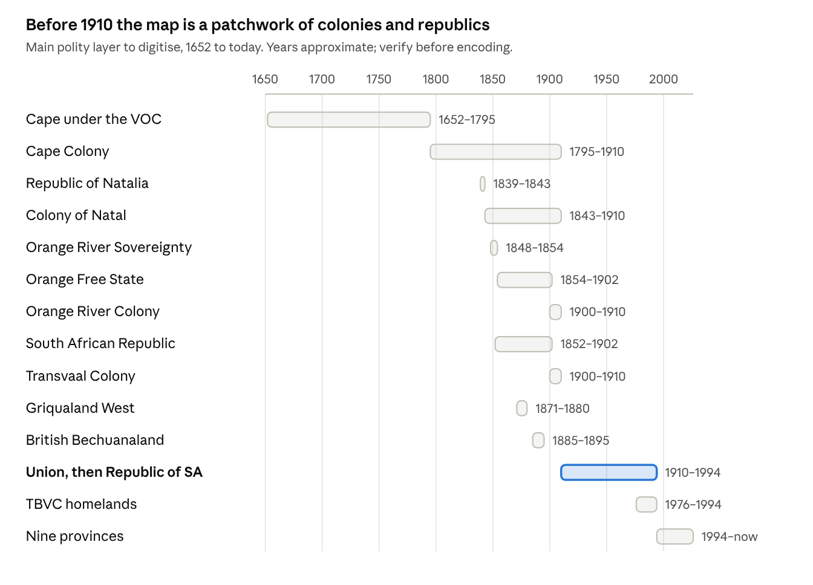

> **Baseline requirements** imported from `Genealogy Map App – Requirements.docx` (2026-10-13). This file is the reference that Intent and Spec issues cite by requirement ID.
> Changes to it arrive through an approved Intent issue. They are never edited in directly.

# Genealogy Map App — Requirements

Oct 13, 2026 · @Louw

## Purpose and scope

A private, single-user web app for placing the user's ancestors on a map of South Africa as it was on any date from 1652 to today. Moving a date control redraws the colonial, republican, provincial and homeland boundaries of that moment, and shows where each person was at the time.

**In scope for v1**

- Interactive map with historical boundary layers, 1652 to present

- A live date control that redraws boundaries, names and pins as it moves

- People and family relationships, entered in-app

- Pinning a person to an address or place for a date or date range, with sources

- An automatic "which district and colony was this in, then?" lookup for every pin

**Users:** one in v1. No sign-up or sharing, but the data must stay private and be backed up, and adding users later must not need a rebuild (NFR-09).

**How to read this spec:** it is written for delivery with AI agents. Every requirement has an ID, a priority (Must, Should, Could) and testable wording. Agents cite IDs in plans, commits and PRs, and a milestone is done when its listed IDs pass their checks.

The long pole is data, not code: researching and digitising 300+ years of shifting boundaries will take far more effort than building the map.

## Key concepts

These terms are used exactly as defined below throughout the spec and the code.

| Term               | Meaning                                                                                                             |
| ------------------ | ------------------------------------------------------------------------------------------------------------------- |
| Account            | A sign-in. Separate from Person: the human who signs in may also be a Person in a Tree, but nothing links the two   |
| Tree               | The people, relationships, pins, sources and places that one or more Accounts work on                               |
| Person             | An individual in the family tree, with names, life dates and notes                                                  |
| Relationship       | A parent–child or spouse link between two people, optionally dated                                                  |
| Place              | A physical location (coordinates), independent of what it was called or who governed it                             |
| Place name         | A name a place carried for a period, e.g. Port Elizabeth, renamed Gqeberha in 2021                                  |
| Address            | The location exactly as written in a record: farm name, erf, street, district. Stored verbatim, never "corrected"   |
| Pin                | A person tied to a place for a date or date range, with an event type and sources                                   |
| Polity             | A governing unit: colony, republic, province, homeland, or district                                                 |
| Boundary version   | The shape of one polity, valid between two dates                                                                    |
| Jurisdiction chain | The polities containing a point on a date, e.g. district Graaff-Reinet → Cape Colony                                |
| Map date           | The date currently selected on the date control                                                                     |
| Fuzzy date         | A genealogical date with a qualifier: exact, about, before, after, between, from–to; may be year-only or month-year |

## Map and live date control

The map is the main screen; changing the map date must feel instant, with no reload or spinner.

| ID     | Requirement                                                                                                                            | Priority |
| ------ | -------------------------------------------------------------------------------------------------------------------------------------- | -------- |
| MAP-01 | Pan and zoom a map of South Africa, with Lesotho, eSwatini and neighbouring border areas for context                                   | Must     |
| MAP-02 | Basemap shows terrain, coastline and major rivers but no modern borders, so present-day lines never leak into a historical view        | Must     |
| MAP-03 | Date control: a slider plus a typed date field, range 1652-01-01 to today. Steps by year by default; month and day precision on demand | Must     |
| MAP-04 | Boundaries, labels and pins redraw live while the slider is dragged, not only on release                                               | Must     |
| MAP-05 | Boundary layers by level (polity, district), each toggled on or off independently                                                      | Must     |
| MAP-06 | Every label shows the name valid on the map date                                                                                       | Must     |
| MAP-07 | Clicking anywhere shows the jurisdiction chain at that point on the map date                                                           | Should   |
| MAP-08 | Preset buttons for key epochs: 1652, 1806, 1854, 1880, 1902, 1910, 1976, 1994, today                                                   | Should   |
| MAP-09 | A play button animates through time at a chosen speed (e.g. 1, 5 or 10 years per second)                                               | Should   |
| MAP-10 | Map date, view and active layers are kept in the URL, so any view can be bookmarked                                                    | Should   |
| MAP-11 | Boundaries that changed since the previous step are briefly outlined                                                                   | Could    |
| MAP-12 | Swipe or side-by-side compare of two dates                                                                                             | Could    |

**Acceptance checks**

- Given map date 1875, when the user clicks on Kimberley, then the panel shows Griqualand West.

- Given map date 1900-01-01, when the user clicks on Bloemfontein, then the panel shows Orange Free State.

- Dragging the slider from 1890 to 1915 shows the Boer republics give way to colonies and then to the four Union provinces, with no frame taking longer than the target in NFR-01.

## Historical boundaries and names

Boundaries are data with dates attached, never hard-coded: each shape is valid for a period, and names change separately from shapes.

| ID     | Requirement                                                                                                                                | Priority |
| ------ | ------------------------------------------------------------------------------------------------------------------------------------------ | -------- |
| BND-01 | Each boundary version stores polity, level, geometry, valid-from, valid-to (open = still current), source and confidence                   | Must     |
| BND-02 | Polity names have their own dated history, separate from geometry (a renamed province keeps its shape)                                     | Must     |
| BND-03 | Which polity sits inside which is dated too (a district moves from one colony to another)                                                  | Must     |
| BND-04 | Overlapping claims are allowed when flagged as contested (e.g. 1900–1902, British annexation vs. Boer governments) and drawn with hatching | Must     |
| BND-05 | Approximate borders carry a low confidence and are drawn dashed                                                                            | Must     |
| BND-06 | Boundary data lives as GeoJSON files in the repo, under version control                                                                    | Must     |
| BND-07 | A validation script runs in CI: valid geometry, no gaps in a polity's date ranges, no unflagged overlaps at the same level on any date     | Must     |
| BND-08 | Place-name history for towns and features, shown on the map by date                                                                        | Should   |
| BND-09 | In-app editor to draw or adjust a boundary and set its dates                                                                               | Could    |
| BND-10 | Approximate "areas of influence" layer for African polities and chiefdoms, clearly labelled as approximate                                 | Could    |

**Acceptance checks**

- The validator fails a fixture where two provinces overlap on 1950-01-01 without a contested flag.

- Given map date 2020 a label reads Port Elizabeth; given 2022 it reads Gqeberha.

## People and pins

A pin says "this person was here, at this time, and this is how the user knows"; the app then works out which district and colony that was.

**People and relationships**

| ID     | Requirement                                                                                                                                                        | Priority |
| ------ | ------------------------------------------------------------------------------------------------------------------------------------------------------------------ | -------- |
| PPL-01 | Create and edit a person: given names, surname, maiden name, spelling variants (e.g. Van der Merwe, v.d. Merwe), sex, birth and death as fuzzy dates, notes, photo | Must     |
| PPL-02 | Relationships: parent–child (biological, adoptive, step) and spouse, with marriage and divorce dates                                                               | Must     |
| PPL-03 | A simple pedigree or descendants view to move around the family                                                                                                    | Should   |

**Pins**

| ID     | Requirement                                                                                                                                                                   | Priority |
| ------ | ----------------------------------------------------------------------------------------------------------------------------------------------------------------------------- | -------- |
| PIN-01 | Create a pin by clicking the map, searching a known place, or typing coordinates; then choose the person, date and event type                                                 | Must     |
| PIN-02 | Pin fields: person, place, address as recorded (verbatim), precision (street address, building, erf, farm, suburb, town or city, district, province, approximate), event type, fuzzy date or date range, sources, notes | Must     |
| PIN-03 | Event types: birth, baptism, residence, marriage, death, burial, land ownership, occupation, other                                                                            | Must     |
| PIN-04 | Fuzzy dates follow GEDCOM conventions: exact, ABT, BEF, AFT, BET…AND, FROM…TO, plus EST (estimated) and CAL (calculated); precision is day (YYYYMMDD), month (YYYYMM) or year (YYYY)                                                               | Must     |
| PIN-05 | On save, the jurisdiction chain at the pin's date is computed and shown; it is recomputed when boundary data changes                                                          | Must     |
| PIN-06 | Many pins can share one place (a family farm across generations)                                                                                                              | Must     |
| PIN-07 | Sources are records of their own (title, repository, archive reference, URL, scan) linked to pins and person facts                                                            | Should   |
| PIN-08 | Warnings for impossible pins: dated before birth or after death, or overlapping residences                                                                                    | Should   |
| PIN-09 | Drag a pin to correct its location                                                                                                                                            | Could    |
| PIN-10 | A pin with no place may take the place of the Person's previous pin, marked as inferred and replaceable | Could |
| PIN-11 | A Person with no birth date may show their baptism date in its place, marked as derived; the birth date is never overwritten | Could |

**Acceptance checks**

- Given a residence pin at "Farm Rietfontein, district Graaff-Reinet" from 1840 to 1855, it shows at map date 1850 and is hidden at 1860.

- Given a pin dated "ABT 1850", it shows with an uncertainty halo between roughly 1845 and 1855 (window configurable).

- Saving a pin dated 1870 inside today's Free State stores "Orange Free State" as its polity.

## Exploring the family over time

The map date drives everything: only pins true on that date are shown, and uncertainty is visible rather than hidden.

| ID     | Requirement                                                                                                                                                                        | Priority |
| ------ | ---------------------------------------------------------------------------------------------------------------------------------------------------------------------------------- | -------- |
| EXP-01 | Range pins (residence, land ownership) show while the map date falls inside their range; point events (birth, marriage, death) show within a configurable window around their date | Must     |
| EXP-02 | Fuzzy pins render faded or with a halo that grows with their uncertainty                                                                                                           | Must     |
| EXP-03 | Filter pins by person, surname, event type, or branch (ancestors or descendants of a chosen person)                                                                                | Must     |
| EXP-04 | Search people and places; picking a person moves the map to their first pin and sets the map date to it                                                                            | Must     |
| EXP-05 | Person panel: their pins in date order, each with the jurisdiction chain on that date                                                                                              | Should   |
| EXP-06 | Life trail: draw a person's pins as a dated path                                                                                                                                   | Should   |
| EXP-07 | Migration view: trails for all descendants of a chosen person, coloured by generation                                                                                              | Should   |
| EXP-08 | Cluster dense pins (e.g. Cape Town) and expand on zoom                                                                                                                             | Could    |

**Acceptance checks**

- Filtering to "descendants of X" hides every pin of anyone not descended from X.

- With a life trail on, scrubbing the date control highlights the trail segment for the current map date.

## Data model

Everything that changes over time carries a half-open validity interval \[from, to), with an empty "to" meaning still current. Coordinates are WGS84.

| Entity          | Key fields                                                                                                     | Notes                                           |
| --------------- | -------------------------------------------------------------------------------------------------------------- | ----------------------------------------------- |
| Account         | id, sign-in identity                                                                                           | Not linked to a Person (NFR-09)                 |
| Tree            | id, name                                                                                                       |                                                 |
| TreeAccount     | tree id, account id                                                                                            | One row in v1; no roles                         |
| Person          | id, tree id, given names, surname, name variants, sex, birth, death, notes                                     | Birth and death are FuzzyDates                  |
| Relationship    | id, tree id, person A, person B, type (parent of, spouse of), subtype, start, end                              | Subtype: biological, adoptive, step             |
| Place           | id, tree id, lat, lon, precision                                                                               | Physical location only; names live in PlaceName |
| PlaceName       | place id, name, from, to, source id                                                                            | Follows its Place's Tree                        |
| Pin             | id, tree id, person id, place id, address verbatim, event type, date, source ids, notes, jurisdiction (cached) | Cache rebuilt when boundaries change (PIN-05)   |
| Polity          | id, type (colony, republic, province, homeland, district, field cornetcy)                                      |                                                 |
| PolityName      | polity id, name, from, to                                                                                      |                                                 |
| PolityParent    | child id, parent id, from, to                                                                                  | Dated nesting (BND-03)                          |
| BoundaryVersion | id, polity id, level, geometry, from, to, confidence, contested, source id                                     | MultiPolygon, to allow enclaves                 |
| Source          | id, tree id, title, repository, reference, URL, attachment, notes                                              |                                                 |

Polity, PolityName, PolityParent and BoundaryVersion carry no tree id: every Account shares them (NFR-09).

**FuzzyDate** is stored as: qualifier, date 1, date 2 (for ranges), precision (day, month, year), plus derived earliest and latest ISO dates. All date filtering uses the derived earliest–latest pair, so "ABT 1850" and "BET 1848 AND 1852" are queried the same way.

## Boundary data to build

The polity layer needs about 14 major units between 1652 and today, and each later needs its internal districts. Dates below are from general knowledge and must be checked against sources before they go into the data.

SA polity layer · 14 units, 1652 to today

The 1900–1902 overlaps are the contested periods BND-04 exists for: Britain annexed both Boer republics in 1900, but their governments fought on until 1902.

**Also needed, not drawn above:** British Kaffraria and the Transkeian territories (absorbed into the Cape in stages), Zululand, the short-lived Boer mini-republics (Stellaland, Goshen, Nieuwe Republiek), and the British annexation of the Transvaal from 1877 to 1881.

**District layers, in suggested order**

1.  Cape districts, starting with Stellenbosch, Swellendam (1745) and Graaff-Reinet (1786), then their later subdivisions

2.  Magisterial districts of the four Union provinces, 1910–1994, the unit many archival records are organised by

3.  Districts of Natal and the Boer republics

4.  Homeland boundaries, from their creation to 1994

5.  Post-1994 adjustments, including the cross-border province changes of the mid-2000s

**Candidate sources to evaluate:** historical atlases and archive maps (National Archives, university map libraries), government gazette proclamations for district changes, Stats SA and the Municipal Demarcation Board for post-1994 boundaries, and NAAIRS and eGGSA for place names and record jurisdictions. None has been checked yet for licence or digital availability.

## Non-functional requirements

Sized for one researcher with a large family tree: assume up to 2,000 people and 10,000 pins.

| ID     | Requirement                                                                                                                                                                    | Priority |
| ------ | ------------------------------------------------------------------------------------------------------------------------------------------------------------------------------ | -------- |
| NFR-01 | Changing the map date redraws all layers and pins within 100 ms on a mid-range laptop                                                                                          | Must     |
| NFR-02 | First load of the map in under 3 s on a typical home connection                                                                                                                | Should   |
| NFR-03 | Private: sign-in required, no public pages, nothing indexed by search engines                                                                                                  | Must     |
| NFR-04 | Daily automatic backup, plus one-click export of all data as JSON and GeoJSON                                                                                                  | Must     |
| NFR-05 | Desktop-first; usable on a tablet; read-only lookups work on a phone                                                                                                           | Should   |
| NFR-06 | Date control fully usable by keyboard; colour never the only way meaning is shown                                                                                              | Should   |
| NFR-07 | Works offline for reading and adding pins (useful in archives and on farm visits), syncing later                                                                               | Could    |
| NFR-08 | Licence and attribution recorded for every basemap and boundary source, and shown in the app                                                                                   | Must     |
| NFR-09 | Multi-user ready: sign-in is an Account; people, relationships, pins, sources and places belong to a Tree; boundaries, polities and historical maps are shared by all Accounts | Must     |

## Suggested tech approach

The key to a live slider is loading every boundary version once and changing only a layer filter when the date moves, so no data is fetched while scrubbing. The rest is a suggestion, not a requirement.

- **Front end:** React and TypeScript (Vite), with MapLibre GL JS for the map.

- **Time filtering:** each boundary feature carries from and to as integer properties (e.g. days since 1652-01-01); a date change sets one filter expression per layer. This is what meets NFR-01.

- **Large layers:** if districts plus homelands get heavy, serve them as vector tiles (PMTiles) with the same properties.

- **Jurisdiction lookup:** point-in-polygon at the pin date. Turf.js in the browser is enough at this data size; PostGIS if the logic moves server-side.

- **Storage:** Postgres with PostGIS (hosted, e.g. Supabase or Neon) or SQLite for a local-first build. Boundaries stay as GeoJSON in the repo either way (BND-06).

- **Hosting:** Vercel for the front end.

- **Basemap:** hillshade, coastline and rivers only. Rivers matter: the Orange, Vaal, Great Fish and Tugela formed many historical borders.

- **Tests:** Vitest for date and jurisdiction logic, Playwright for the slider and acceptance checks, the boundary validator (BND-07) in CI.

## Build milestones

Prove the live slider with a few easy epochs first, then add people, then spend the long tail on historical data. Each milestone is one agent plan; it closes when its IDs pass their acceptance checks.

1.  **M0 Foundations.** Repo, CLAUDE.md pointing at this spec, stack scaffold, CI with lint, tests and an empty boundary validator. Exit: a blank map deployed.

2.  **M1 Time-aware map.** Boundary model and date control with three easy epochs only: 1910 Union provinces, 1994 provinces, today. Covers MAP-01 to MAP-06, BND-01, BND-02, BND-06, BND-07, NFR-01.

3.  **M2 People and pins.** PPL-01, PPL-02, PIN-01 to PIN-04, PIN-06, persistence and sign-in (NFR-03), NFR-09. Exit: create a person, pin them, watch the pin appear and disappear as the date moves. Also:
    - Given the user's Tree has been entered, when the tech lead creates a second Account, then all the user's people, pins and sources are unchanged and not re-entered.
    - Given two Accounts with separate Trees, when the second signs in, then they see none of the first Tree's people, pins or sources, but the same historical maps.
    - Given v1, when the user uses it, then they see only a sign-in: no sign-up, sharing or account screens.

4.  **M3 Jurisdiction and exploring.** PIN-05, MAP-07, EXP-01 to EXP-05, NFR-04.

5.  **M4 Pre-Union boundaries.** Research and digitise the polity layer from 1652 to 1910 (BND-03 to BND-05), then district layers for the regions the user's family lived in first.

6.  **M5 Apartheid-era homelands and richer views.** Homeland layers, MAP-08, MAP-09, EXP-06, EXP-07, PIN-07, PIN-08.

7.  **M6 Hardening.** Remaining Should and Could items, accessibility (NFR-06), offline (NFR-07).

## Out of scope and open questions

**Not in v1:** sharing or multiple users, GEDCOM import (export may come later), DNA data, integrations with FamilySearch or Ancestry, printed charts, and boundaries beyond South Africa's borders other than as context.

**Open questions**

- [ ] Which families and regions get district-level boundaries first? This sets the order of M4.

- [ ] How deep below districts: drostdy and magisterial districts only, or also field cornetcies (veldkornetskappe), which many early tax and census rolls are organised by?

- [ ] How to show African kingdoms and chiefdoms, whose borders were fluid and poorly recorded?

- [ ] Homelands at full detail with all enclaves, or simplified shapes?

- [x] Hosted (Vercel plus Postgres) or local-first? Hosted (#13).

- [ ] Hide living people's details by default, even in a private app?
